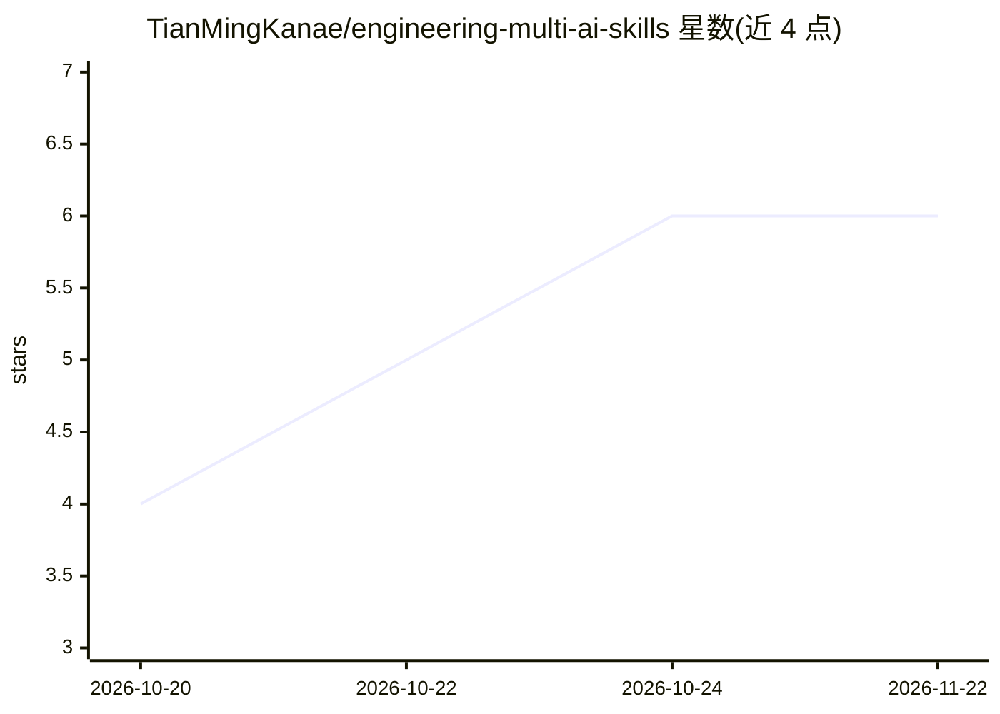

# TianMingKanae/engineering-multi-ai-skills

⭐ 6 · Python · MIT · 推送 2026-10-26 · [GitHub](https://github.com/TianMingKanae/engineering-multi-ai-skills) · 个人维护

**多 AI agent 协作技能库与文件式工作流模板**

面向使用多个 AI agent 的工程团队提供技能包与基于文件的工作流：按 H/O/F/P/C/V/W/A 角色划分职责，通过 SKILL.md 技能、AGENTS.md/CLAUDE.md 模板和 dispatch.py 调度脚本管理任务线程、交接证据与独立评审。无需特定模型、厂商或编程语言，核心工具仅依赖 Python 3.10+ 标准库，可选 HDF5/Parquet/PDF 适配器。含技术写作、文献溯源、执行完整性等 10 个技能。

## 筛选速览

| 维度 | 判定 | 备注 |
|---|---|---|
| AI 角色 | `ai-ecosystem` | LLM/agent 周边工具 |
| 许可风险 | `permissive` | MIT |
| 部署形态 | `None` |  |
| 模型依赖 | — | README 未给出锁定关系 |
| 硬件要求 | — | 无带数字的原话,不猜 |
| 安装摩擦 | `low` | 无编译、无系统依赖或容器化 |
| 成熟度 | — | 结构信号不足 |

## 能力要点

- 10 个 SKILL.md 技能：任务拆分、评审、证据账本、治理、分布式编排等
- H/O/F/P/C/V/W/A 角色职责表与治理模式（决策门、修复配额、盲验证）
- dispatch.py 预览/派发线程，经 runner.json 接入任意 agent CLI，不假设模型名
- 提供 AGENTS.md 与 CLAUDE.md 协作起始模板，可复制到宿主技能目录

## 适用场景

- 让多个 AI 编码助手按实现者/评审者/验证者角色分工完成工程任务
- 为 AI 协作项目建立人类决策门与证据交接流程
- 验证论文/技术文档的引用与证据来源

## 场景标签

`多智能体` `科研工具` · 领域:Agent 开发

## 证据(README 行号)

> L8: Practical skills and a file-based workflow for engineering teams using multiple AI agents. Works with software, infr
> L86: `skills/` holds the canonical copies. Copy selected folders into your agent's configured skill directory. For examp
> L128: - Heterogeneous agents: builder/reviewer/extractor capability contracts, cross-provider isolation and neutral file

## 星数曲线

2026-10-20 4 → 2026-11-22 6（+2）

---
*卡片 v1 · prompt 1.4 · 生成 2026-11-20 · 置信度 high · 依据 README sha `9136d60efa19` · [字段定义](../../DATASET.md)*
