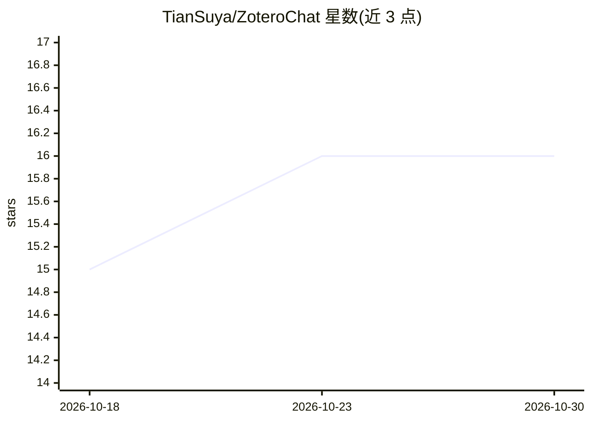

# TianSuya/ZoteroChat

⭐ 16 · TypeScript · NOASSERTION · 推送 2026-10-26 · [GitHub](https://github.com/TianSuya/ZoteroChat) · 个人维护 · 中文 README

**Zotero 阅读器侧边栏论文问答插件：PDF 全文常驻上下文**

Zotero 7-9 的阅读器侧边栏聊天插件：打开的 PDF 全文与元数据固定为提示前缀，支持追问、选中句子开启副对话、行内笔记（不发送给模型）。助手可调用 DeepSeek Search/Fetch 检索网页并给出可点击来源与工具记录；导入文献需逐条确认并校验 PDF。对话与笔记按 PDF 存储于本地 sqlite，可随重开恢复。通过 OpenAI 兼容的 Chat Completions 端点接入任意支持工具调用的模型，默认 DeepSeek。限制：长文自动压缩未实现，笔记不跨设备同步。

## 筛选速览

| 维度 | 判定 | 备注 |
|---|---|---|
| AI 角色 | `ai-native` | 本体是模型或模型工具 |
| 许可风险 | `none` | NOASSERTION |
| 部署形态 | `None` |  |
| 模型依赖 | locked-api |  |
| 硬件要求 | — | 无带数字的原话,不猜 |
| 安装摩擦 | `low` | 无编译、无系统依赖或容器化 |
| 成熟度 | — | 结构信号不足 |

## 能力要点

- 打开的 PDF 全文+元数据作为固定提示前缀，追问无需重复说明
- DeepSeek Search/Fetch 网页检索，附来源链接与工具记录
- 按 PDF 持久化对话、工具记录与笔记于本地 sqlite
- 写入 Zotero 前逐项确认，导入校验 DOI 去重与 PDF 魔数

## 适用场景

- 读论文时直接在阅读器内提问，不切换到独立聊天应用
- 对不清楚的句子就地开副对话或加行内笔记
- 让助手检索相关文献并经确认后导入 Zotero 文库

## 场景标签

`科研工具` `文档问答` · 领域:知识与检索

## 证据(README 行号)

> L11: ZoteroChat turns Zotero's right sidebar into a reading companion. The paper you have open stays in context, so you 
> L21: - **It can check, not just remember.** When outside information matters, the assistant can call DeepSeek Search / F

## 星数曲线

2026-10-18 15 → 2026-10-30 16（+1）

---
*卡片 v1 · prompt 1.4 · 生成 2026-10-30 · 置信度 high · 依据 README sha `bf36a815bcda` · [字段定义](../../DATASET.md)*
