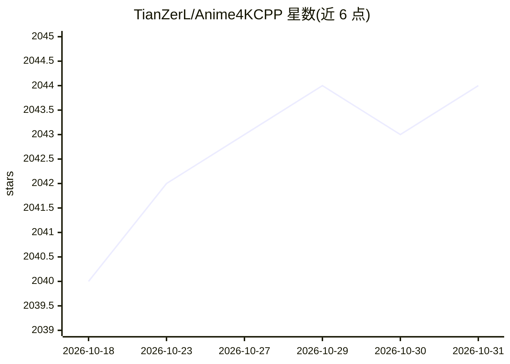

# TianZerL/Anime4KCPP

⭐ 2,044 · C++ · GPL-3.0 · 推送 2026-07-04 · [GitHub](https://github.com/TianZerL/Anime4KCPP) · 个人维护

**基于 CNN 算法的动漫图像/视频高性能放大器**

C++ 实现的动漫图像放大工具，v3 采用 CNN 算法，支持 OpenCL 与 CUDA 后端加速，并提供 Eigen3/SSE/AVX/NEON 等多架构 SIMD 编译选项。源码编译构建，可选构建 CLI、Qt GUI、视频模块（FFmpeg 依赖）、Avisynth/VapourSynth/DirectShow 滤镜及 Python 绑定，覆盖 Windows/Linux/macOS/Termux/WASM 平台。另有浏览器端 WebAssembly Playground 可在线放大图像。许可采用 MIT 与 GPLv3（视频模块）混合。

## 筛选速览

| 维度 | 判定 | 备注 |
|---|---|---|
| AI 角色 | `ai-native` | 本体是模型或模型工具 |
| 许可风险 | `viral` | GPL-3.0 |
| 部署形态 | `None` |  |
| 模型依赖 | — | README 未给出锁定关系 |
| 硬件要求 | — | 无带数字的原话,不猜 |
| 安装摩擦 | `high` | 编译与系统依赖俱全 |
| 成熟度 | — | 结构信号不足 |

## 能力要点

- CNN 算法的动漫图像/视频放大，支持 OpenCL 与 CUDA 加速
- 提供 CLI、Qt GUI、Avisynth/VapourSynth/DirectShow 滤镜与 Python 绑定等可选模块
- 多平台 SIMD 支持（x86 SSE/AVX、ARM NEON、RISC-V RVV、LoongArch、MIPS 等）
- 浏览器端 WebAssembly Playground 在线放大图像

## 适用场景

- 放大动漫图片或视频提升分辨率
- 作为 Avisynth/VapourSynth 滤镜用于视频处理管线
- 在浏览器中直接试用放大效果

## 场景标签

`图像视频处理` · 领域:感知与多模态

## 证据(README 行号)

> L7: Anime4KCPP is a high performance anime upscaler.
> L9: Anime4KCPP v3 uses CNN based algorithm, and aims to be simple and efficient.

## 星数曲线

2026-10-18 2,040 → 2026-10-31 2,044（+4）

---
*卡片 v1 · prompt 1.4 · 生成 2026-10-21 · 置信度 high · 依据 README sha `c3105ff4f76c` · [字段定义](../../DATASET.md)*
