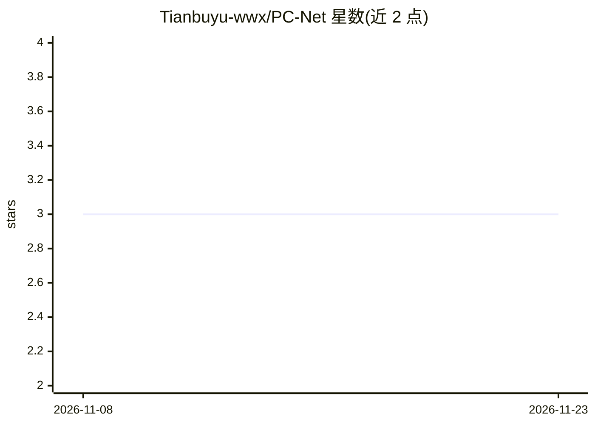

# Tianbuyu-wwx/PC-Net

⭐ 3 · Python · MIT · 推送 2026-11-03 · [GitHub](https://github.com/Tianbuyu-wwx/PC-Net) · 个人维护 · 中文 README

**水质概率预测的层级预测编码网络研究代码**

PC-Net 是用于水质预测的层级预测编码网络的 PyTorch 实现：在多层分辨率金字塔上以预测编码自由能驱动推理，输出点预测与九分位数概率预测，0.655M 参数单次前向完成。配套太湖 7 站 6 指标、4 小时粒度的数据处理流程，仅随附 3 站 Parquet 数据，完整七站表需自行提供路径。提供训练、消融（命令行开关）与评估命令，输出 MAE/RMSE/R²/nQS₉ 及逐步 CSV。

## 筛选速览

| 维度 | 判定 | 备注 |
|---|---|---|
| AI 角色 | `ai-native` | 本体是模型或模型工具 |
| 许可风险 | `permissive` | MIT |
| 部署形态 | `None` |  |
| 模型依赖 | — | README 未给出锁定关系 |
| 硬件要求 | `cpu-ok` | |
| 安装摩擦 | `medium` | 含编译或系统依赖之一 |
| 成熟度 | — | 结构信号不足 |

## 能力要点

- 预测编码自由能驱动的多分辨率层级推理（T_inf=6 步、无额外参数）
- 加性解码加残差分位数头，一次前向同时输出点与概率预测
- 与 15 个基线模型在同一协议下对比，含 TimesFM/Chronos 等基础模型
- 提供 6 个深度基线的复现代码与消融实验命令行开关

## 适用场景

- 复现论文中的太湖水质多步预测实验
- 在自己的时间序列表上训练与评估分位数预测模型
- 做预测编码或层级模型的消融研究
- 对比基础模型与任务专用模型的微调成本

## 场景标签

 · 领域:科研/时序预测

## 证据(README 行号)

> L8: PC-Net: A Hierarchical Predictive Coding Network for Probabilistic Multi-horizon Water-Quality Forecasting
> L13: - ***Additive decoding and residual quantile head***: each level contributes a coarse-to-fine point forecast and on
> L41: The records are surface-water measurements published by the China National Environmental Monitoring Center (https:/

## 星数曲线

2026-11-08 3 → 2026-11-23 3（+0）

---
*卡片 v1 · prompt 1.4 · 生成 2026-11-22 · 置信度 high · 依据 README sha `e56bdeb3dc41` · [字段定义](../../DATASET.md)*
