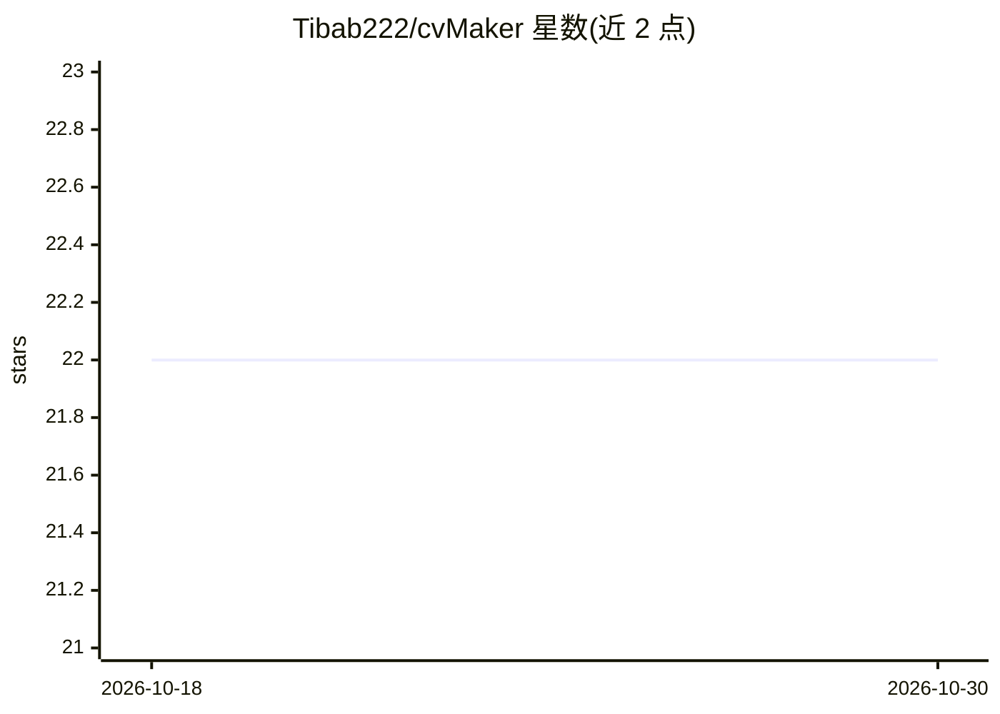

# Tibab222/cvMaker

⭐ 22 · TypeScript · MIT · 推送 2026-09-22 · [GitHub](https://github.com/Tibab222/cvMaker) · 个人维护

**本地优先的开源简历与求职管理桌面平台，含语义匹配**

基于 Electron + React + TypeScript 的本地优先求职管理应用：以看板跟踪申请流程（Wishlist 到 Offered 等六阶段），通过配套浏览器扩展一键抓取 LinkedIn、Indeed 等职位信息。匹配引擎三步运行：用 transformers.js（all-MiniLM-L6-v2）在 SQLite 中做本地向量化，对 JD 做关键词提取或 LLM 解析（可选 Ollama 自动检测/配置或 Gemini API），再以余弦相似度挑选经历文本块并导出定制 PDF。无 LLM 时回退到本地向量计算与关键词规则。源码方式运行。

## 筛选速览

| 维度 | 判定 | 备注 |
|---|---|---|
| AI 角色 | `ai-enhanced` | 去掉 AI 部分产品仍成立 |
| 许可风险 | `permissive` | MIT |
| 部署形态 | `None` |  |
| 模型依赖 | local-ok | 支持本地模型 |
| 硬件要求 | — | 无带数字的原话,不猜 |
| 安装摩擦 | `low` | 无编译、无系统依赖或容器化 |
| 成熟度 | — | 结构信号不足 |

## 能力要点

- transformers.js + SQLite 本地向量化与语义相似度匹配
- Ollama 自动检测与配置，Gemini API 可选，无 LLM 时离线回退
- 看板式申请流程跟踪与浏览器扩展抓取职位
- 按 JD 匹配度动态取舍经历块并导出 PDF 简历

## 适用场景

- 本地管理求职申请流程，不依赖云服务
- 针对具体 JD 定制简历并查看匹配评分
- 用浏览器扩展一键收集招聘网站的职位信息

## 场景标签

`AI 写作` · 领域:内容生成

## 证据(README 行号)

> L21: **CV Maker Engine** is a local-first, open-source personal recruitment command center. It bridges application track
> L30: * **Hybrid Matching Engine:**

## 星数曲线

2026-10-18 22 → 2026-10-30 22（+0）

---
*卡片 v1 · prompt 1.4 · 生成 2026-10-28 · 置信度 high · 依据 README sha `f7ee39a15e99` · [字段定义](../../DATASET.md)*
