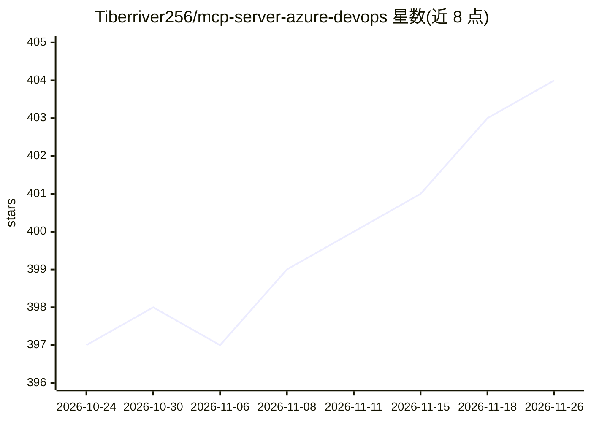

# Tiberriver256/mcp-server-azure-devops

⭐ 404 · TypeScript · MIT · 推送 2026-11-25 · [GitHub](https://github.com/Tiberriver256/mcp-server-azure-devops) · 组织维护

**让 AI 助手经 MCP 协议操作 Azure DevOps 的服务器**

实现 Model Context Protocol 的服务器，充当 AI 助手与 Azure DevOps API 之间的桥梁：提供 77 个工具、13 个工具集，覆盖项目、工作项、仓库、PR、流水线、Wiki、测试计划、OData 分析与实时事件。支持 stdio 与 Streamable HTTP 传输、Docker 打包、PAT/Azure Identity/Azure CLI 三种认证、只读模式与工具过滤预设，并默认启用 prompt-injection Spotlighting。README 注明微软另维护官方云版 MCP，本社区版适合本地部署（on-premises）或官方版未覆盖的功能。

## 筛选速览

| 维度 | 判定 | 备注 |
|---|---|---|
| AI 角色 | `ai-ecosystem` | LLM/agent 周边工具 |
| 许可风险 | `permissive` | MIT |
| 部署形态 | `library` | 以包/库形式分发 |
| 模型依赖 | — | README 未给出锁定关系 |
| 硬件要求 | — | 无带数字的原话,不猜 |
| 安装摩擦 | `low` | 无编译、无系统依赖或容器化 |
| 成熟度 | — | 结构信号不足 |

## 能力要点

- 77 个工具、13 个工具集，覆盖工作项/仓库/PR/流水线/测试计划等
- 支持 stdio 与 Streamable HTTP 传输及 Docker 打包
- 三种认证方式：PAT、Azure Identity、Azure CLI；on-prem 仅支持 PAT
- 只读模式、工具过滤预设与默认启用的 Spotlighting 防注入机制

## 适用场景

- 让 Claude Desktop 或 Cursor 通过自然语言创建工作项、审查 PR、触发流水线
- 本地部署 Azure DevOps Server 团队接入 AI 助手
- 以只读模式向 AI 暴露 DevOps 数据避免误操作

## 场景标签

 · 领域:DevOps/AI 工具集成

## 证据(README 行号)

> L3: A Model Context Protocol (MCP) server implementation for Azure DevOps, allowing AI assistants to interact with Azure
> L11: This server implements the Model Context Protocol (MCP) for Azure DevOps, enabling AI assistants like Claude to int
> L21: The server is structured around the Model Context Protocol (MCP) for communicating with AI assistants. It provides 

## 星数曲线

2026-10-24 397 → 2026-11-26 404（+7）

---
*卡片 v1 · prompt 1.4 · 生成 2026-11-26 · 置信度 high · 依据 README sha `d26d61251e67` · [字段定义](../../DATASET.md)*
