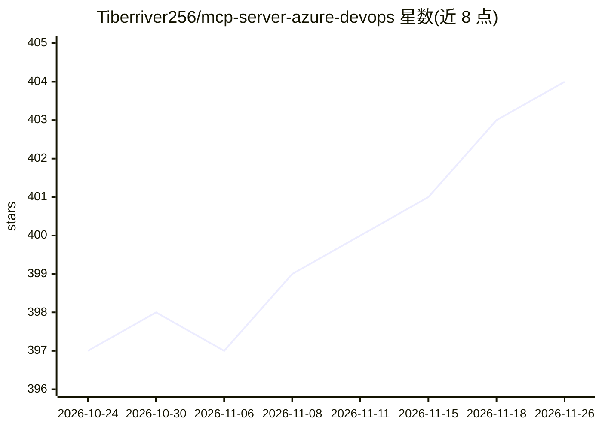

# Tiberriver256/mcp-server-azure-devops

⭐ 404 · TypeScript · MIT · 推送 2026-11-25 · [GitHub](https://github.com/Tiberriver256/mcp-server-azure-devops) · 组织维护

**让 AI 助手经 MCP 协议操作 Azure DevOps 的服务器**

实现 Model Context Protocol 的 Azure DevOps 服务器，在 AI 助手（如 Claude）与 Azure DevOps API 之间充当桥接，提供项目、工作项、仓库、分支、流水线、Wiki、测试计划等工具集。支持 PAT、Azure Identity、Azure CLI 三种认证方式；提供工具过滤、只读模式（fail-closed）等安全控制；通过 npx 运行发布包或从源码构建。另注明 Microsoft 维护官方版，本社区版适用于本地部署的 Azure DevOps Server 及官方版尚未覆盖的功能。

## 筛选速览

| 维度 | 判定 | 备注 |
|---|---|---|
| AI 角色 | `ai-ecosystem` | LLM/agent 周边工具 |
| 许可风险 | `permissive` | MIT |
| 部署形态 | `library` | 以包/库形式分发 |
| 模型依赖 | — | README 未给出锁定关系 |
| 硬件要求 | — | 无带数字的原话,不猜 |
| 安装摩擦 | `low` | 无编译、无系统依赖或容器化 |
| 成熟度 | — | 结构信号不足 |

## 能力要点

- 提供工作项、仓库、PR、流水线、Wiki、测试计划等多组 MCP 工具
- 支持 PAT / Azure Identity / Azure CLI 三种认证方式
- 工具集过滤与只读模式（--read-only 为 fail-closed）
- 支持本地部署版 Azure DevOps Server（仅 PAT 认证）

## 适用场景

- 用自然语言创建和更新工作项、分支与 PR
- 让 AI 助手查询流水线状态并触发运行
- 在 Claude Desktop / Cursor 中接入 Azure DevOps 资源
- 管理本地部署的 Azure DevOps Server（旧版本）

## 场景标签

 · 领域:开发工具/DevOps 基础设施

## 证据(README 行号)

> L3: A Model Context Protocol (MCP) server implementation for Azure DevOps, allowing AI assistants to interact with Azure
> L11: This server implements the Model Context Protocol (MCP) for Azure DevOps, enabling AI assistants like Claude to int

## 星数曲线

2026-10-24 397 → 2026-11-26 404（+7）

---
*卡片 v1 · prompt 1.4 · 生成 2026-11-25 · 置信度 high · 依据 README sha `659758ab0d2c` · [字段定义](../../DATASET.md)*
