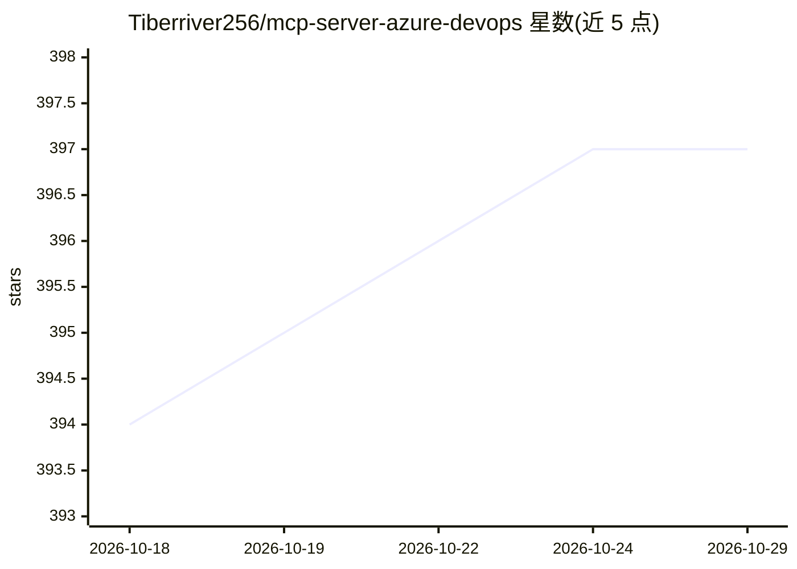

# Tiberriver256/mcp-server-azure-devops

⭐ 397 · TypeScript · MIT · 推送 2026-10-26 · [GitHub](https://github.com/Tiberriver256/mcp-server-azure-devops) · 个人维护

**让 AI 助手通过 MCP 协议操作 Azure DevOps 的社区服务器**

实现 Model Context Protocol 的 Azure DevOps 服务器，作为 AI 助手与 Azure DevOps API 之间的桥接层，提供项目、工作项、仓库、分支、拉取请求、流水线、Wiki、搜索等工具集，支持创建/更新工作项、提交代码、触发流水线等操作。认证支持 PAT、Azure Identity 与 Azure CLI 三种方式。README 明确其为社区服务器：Azure DevOps Server（本地部署版，仅支持 PAT）及官方服务器尚未覆盖的功能是其适用场景，云版用户被指引优先使用 Microsoft 官方 MCP。以 npm 包形式分发，也可从源码构建运行。

## 筛选速览

| 维度 | 判定 | 备注 |
|---|---|---|
| AI 角色 | `ai-ecosystem` | LLM/agent 周边工具 |
| 许可风险 | `permissive` | MIT |
| 部署形态 | `library` | 以包/库形式分发 |
| 模型依赖 | — | README 未给出锁定关系 |
| 硬件要求 | — | 无带数字的原话,不猜 |
| 安装摩擦 | `low` | 无编译、无系统依赖或容器化 |
| 成熟度 | — | 结构信号不足 |

## 能力要点

- 覆盖项目/工作项/仓库/PR/流水线/Wiki/搜索的工具集（约 40+ 个工具）
- 支持 Azure DevOps Server（本地部署版，旧版本亦可）
- 三种认证方式：PAT、Azure Identity、Azure CLI
- npx 一行命令运行已发布包

## 适用场景

- 在 Claude Desktop/Cursor 等客户端中用自然语言操作 Azure DevOps
- 本地部署（on-prem）Azure DevOps Server 用户接入 MCP
- 通过对话创建工作项、提交代码、触发流水线

## 场景标签

 · 领域:开发者工具/AI 工具接入

## 证据(README 行号)

> L3: A Model Context Protocol (MCP) server implementation for Azure DevOps, allowing AI assistants to interact with Azure
> L11: This server implements the Model Context Protocol (MCP) for Azure DevOps, enabling AI assistants like Claude to int

## 星数曲线

2026-10-18 394 → 2026-10-29 397（+3）

---
*卡片 v1 · prompt 1.4 · 生成 2026-10-21 · 置信度 high · 依据 README sha `ca5b01b37b61` · [字段定义](../../DATASET.md)*
