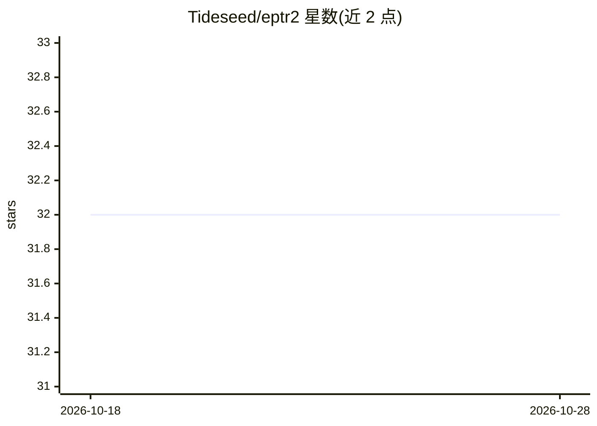

# Tideseed/eptr2

⭐ 32 · Python · Apache-2.0 · 推送 2026-10-21 · [GitHub](https://github.com/Tideseed/eptr2) · [官网](https://robokami.com) · 组织维护

**土耳其电力/天然气市场透明平台 API 的 Python 客户端**

非官方的 EPIAS 透明平台 2.0 API Python 客户端，覆盖土耳其电力与天然气市场的 232 个数据服务：PTF/SMF 价格、消费、发电、生产计划、市场运营与不平衡成本。所有服务通过统一 call 方法与端点 key 访问，另提供类型化包装函数、组合函数、凭据免需的 API 发现命令（list/search/describe）以及纯函数的不平衡/KÜPST 成本计算。面向 AI agent 提供与厂商无关的工具：MCP 服务器（18 个工具）、7 个可安装技能、AGENTS.md 与全量机器可读 schema。Apache License 2.0。

## 筛选速览

| 维度 | 判定 | 备注 |
|---|---|---|
| AI 角色 | `ai-enhanced` | 去掉 AI 部分产品仍成立 |
| 许可风险 | `permissive` | Apache-2.0 |
| 部署形态 | `library` | 以包/库形式分发 |
| 模型依赖 | — | README 未给出锁定关系 |
| 硬件要求 | — | 无带数字的原话,不猜 |
| 安装摩擦 | `low` | 无编译、无系统依赖或容器化 |
| 成熟度 | — | 结构信号不足 |

## 能力要点

- 统一 call 模式访问 232 个端点，支持土耳其语别名
- MCP 服务器向 VS Code/Claude/Cursor 等客户端提供 18 个工具
- eptr2 install-skills 安装 7 个 agent 技能，eptr2 schema 输出全量端点 schema
- 不平衡/KÜPST 成本为纯函数计算，无需 API 调用与凭据

## 适用场景

- 获取土耳其电力市场的价格、消费与发电数据
- 让 AI 助手通过自然语言查询市场数据并计算不平衡成本
- 通过 CLI 管道化获取 JSON/CSV 输出

## 场景标签

 · 领域:能源/电力市场数据

## 证据(README 行号)

> L10: `eptr2` (**EP**IAS **Tr**ansparency **2**.0) is a Python client for the EPIAS Transparency Platform v2.0 API, cover
> L139: `eptr2` ships provider-agnostic tooling — nothing is tied to one model vendor. There are three ways to use it, dep

## 星数曲线

2026-10-18 32 → 2026-10-28 32（+0）

---
*卡片 v1 · prompt 1.4 · 生成 2026-10-26 · 置信度 high · 依据 README sha `bdca2f14c6b8` · [字段定义](../../DATASET.md)*
