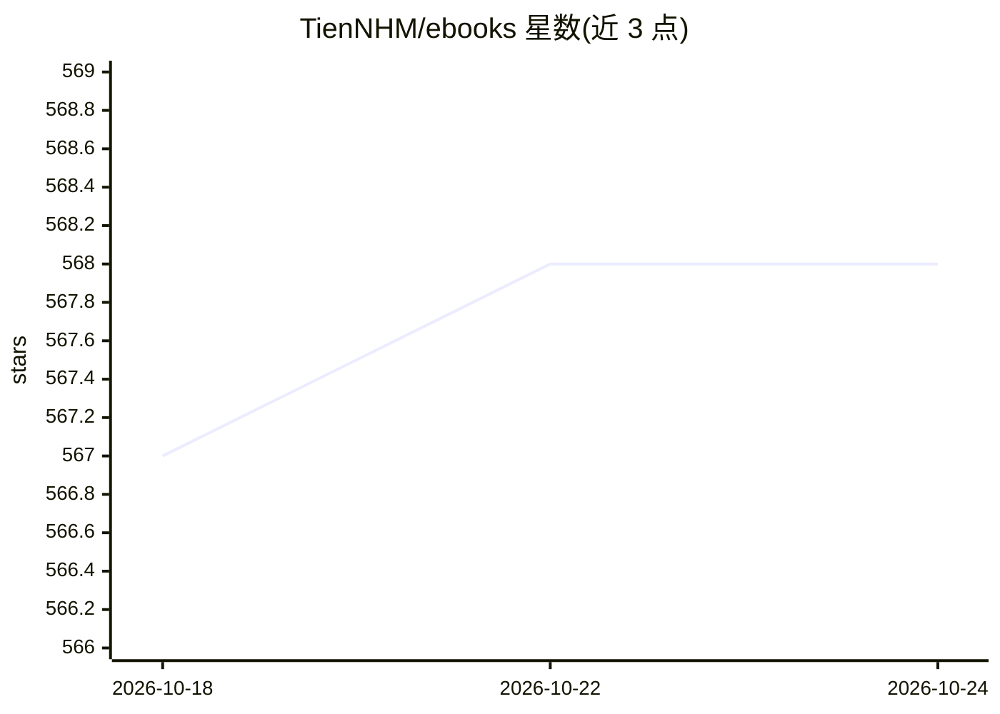

# TienNHM/ebooks

⭐ 568 · 推送 2026-10-02 · [GitHub](https://github.com/TienNHM/ebooks) · [官网](http://tiennhm.io.vn/ebooks/) · 个人维护

**信息技术领域电子书聚合清单，面向程序员与学生**

由个人维护的越南语 IT 电子书收藏仓库，按约 30 个主题分类组织书籍链接，覆盖 AI 与机器学习、LLM、算法、离散数学、C/C++、C#、Java、Python、ReactJS、数据库、网络、操作系统、编译器、软件工程、系统设计、测试、电商、竞赛编程与 IT 面试等。README 以目录表形式罗列分类与“查看书籍”链接，通过 Pull Request 接受新增书籍，并声明内容仅用于学习与非商业目的，使用者需遵守各书版权条款。仓库本身不包含模型或代码，是纯链接索引。

## 筛选速览

| 维度 | 判定 | 备注 |
|---|---|---|
| AI 角色 | `ai-knowledge` | 知识聚合/清单类 |
| 许可风险 | `none` | — |
| 部署形态 | `None` |  |
| 模型依赖 | — | README 未给出锁定关系 |
| 硬件要求 | — | 无带数字的原话,不猜 |
| 安装摩擦 | `low` | 无编译、无系统依赖或容器化 |
| 成熟度 | — | 结构信号不足 |

## 能力要点

- 约 30 个 IT 主题分类的电子书链接索引
- 包含 AI/机器学习与 LLM 专门分类
- 通过 Pull Request 接受社区新增书籍

## 适用场景

- 按主题查找 IT 学习电子书
- 为算法、数据库、系统设计等课程寻找参考资料
- 准备 IT 面试时查找相关书籍

## 场景标签

`精选清单` · 领域:学习与行业

## 证据(README 行号)

> L3:  📚 Bộ sưu tập Ebooks ngành Công nghệ Thông tin
> L18: ## 📂 Danh mục sách
> L22: |🤖 AI & Học máy|Xem sách|

## 星数曲线

2026-10-18 567 → 2026-10-24 568（+1）

---
*卡片 v1 · prompt 1.4 · 生成 2026-10-21 · 置信度 high · 依据 README sha `8be07208650a` · [字段定义](../../DATASET.md)*
