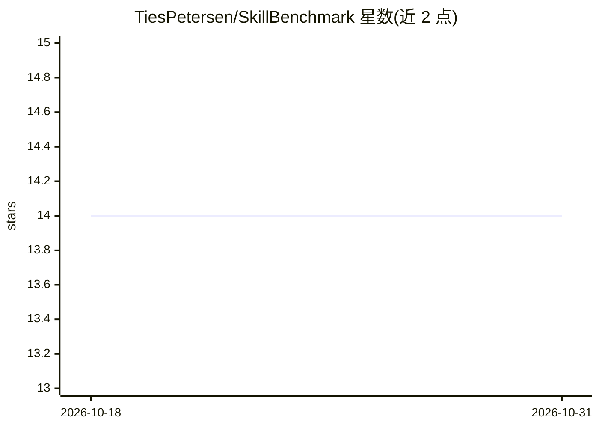

# TiesPetersen/SkillBenchmark

⭐ 14 · Python · MIT · 推送 2026-05-26 · [GitHub](https://github.com/TiesPetersen/SkillBenchmark) · 个人维护

**评测 Agent Skills 是否真实提升 LLM 输出质量的基准套件**

面向 Agent Skills（SKILL.md）作者的评测工具：同一任务对同一模型分别以带技能注入与不带技能的系统提示运行 N 次，由盲评 judge LLM 按 rubric 打分，再用 t 分布与 Welch 区间计算两组得分差值及置信区间，判断技能提升是否统计显著。Judge 看不到任务提示、也不知道哪个输出使用了技能，以控制偏差。当前 v1 仅支持单轮文本调用，不支持多轮 agentic 任务；需配置 Anthropic API key，附带 Caveman 技能示例与可复现的 JSON/markdown 结果输出。

## 筛选速览

| 维度 | 判定 | 备注 |
|---|---|---|
| AI 角色 | `ai-ecosystem` | LLM/agent 周边工具 |
| 许可风险 | `permissive` | MIT |
| 部署形态 | `library` | 以包/库形式分发 |
| 模型依赖 | locked-api |  |
| 硬件要求 | — | 无带数字的原话,不猜 |
| 安装摩擦 | `low` | 无编译、无系统依赖或容器化 |
| 成熟度 | `idea` | |

## 能力要点

- 同一模型带/不带技能双路输出 + 盲评 judge 打分的对照设计
- t 分布与 Welch 置信区间量化技能提升的统计显著性
- 支持配置多 runner 多 judge 以收紧置信区间
- 结果以 markdown 报告与含逐次输出的 JSON 日志形式可复现

## 适用场景

- 发布 Agent Skill 前量化它对输出质量与 token 成本的影响
- 比较技能在不同任务类型上的效果一致性
- 决定某个技能是否值得其额外 token 开销

## 场景标签

`模型评测` `提示工程` · 领域:Agent 开发

## 证据(README 行号)

> L17: Each task is run N times. Every run produces two outputs from the same LLM: one with the skill injected as the syst

## 星数曲线

2026-10-18 14 → 2026-10-31 14（+0）

---
*卡片 v1 · prompt 1.4 · 生成 2026-10-31 · 置信度 mid · 依据 README sha `d55a76d6a279` · [字段定义](../../DATASET.md)*
