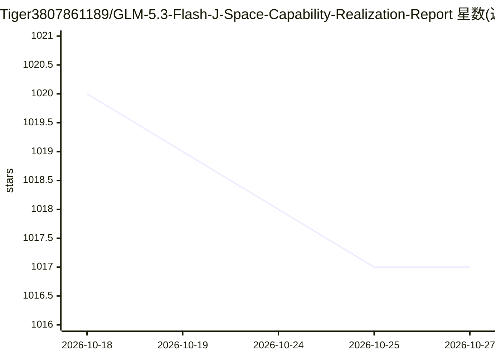

# Tiger3807861189/GLM-5.3-Flash-J-Space-Capability-Realization-Report

⭐ 1,017 · NOASSERTION · 推送 2026-09-05 · [GitHub](https://github.com/Tiger3807861189/GLM-5.3-Flash-J-Space-Capability-Realization-Report) · 个人维护 · 中文 README

**推理时 Agent 工作区控制技能包，跨模型增强长任务与验证**

面向 AI host 的模型无关推理时控制系统，以 Skill 形式打包：单入口、九个可选加载模块、四份参考文档和一个可选的标准库控制器。将 agent 的工作表示组织为受管理的工作区，提供 fast/full/loop 三档运行模式、选择性加载、广播枢纽、检验与恢复等机制；控制器把 loop 状态外置到 .jspace/ 目录。模型权重与训练不变，安装方式为手动复制 j-space/ 目录到宿主 Skills 目录，或由 agent 代为安装。附 GLM-5.3-Flash 基准表（结果标注为有限受控实验估计），效果在 DeepSeek/Qwen/GLM/GPT/Claude 各模型家族上复现。

## 筛选速览

| 维度 | 判定 | 备注 |
|---|---|---|
| AI 角色 | `ai-ecosystem` | LLM/agent 周边工具 |
| 许可风险 | `none` | NOASSERTION |
| 部署形态 | `None` |  |
| 模型依赖 | — | README 未给出锁定关系 |
| 硬件要求 | — | 无带数字的原话,不猜 |
| 安装摩擦 | `low` | 无编译、无系统依赖或容器化 |
| 成熟度 | — | 结构信号不足 |

## 能力要点

- 单入口 + 九个模块 + 可选控制器的推理时工作区管理
- fast/full/loop 三档按任务规模选择性加载
- 可选控制器将长任务状态外置到 .jspace/（Python 标准库实现）
- 附 verify_suite.py 完整性校验与三平台 CI 回归测试

## 适用场景

- 为 AI agent 增加长程多阶段任务的状态管理与恢复
- 在交付前对输出做 checkpoint 记录与 register 检查
- 在不改模型权重的前提下补充推理时验证与元认知控制

## 场景标签

`Agent 记忆` · 领域:Agent 开发

## 证据(README 行号)

> L7: J-Space Cognition Suite is a model-agnostic inference-time control system for deep reasoning, long-horizon work, too
> L9: It is packaged as a Skill for cross-platform use, selective loading, and low-friction integration.
> L13: J-Space operates at inference time. Model weights and training remain unchanged.

## 星数曲线

2026-10-18 1,020 → 2026-10-27 1,017（-3）

---
*卡片 v1 · prompt 1.4 · 生成 2026-10-21 · 置信度 high · 依据 README sha `7e36e1ab4d78` · [字段定义](../../DATASET.md)*
