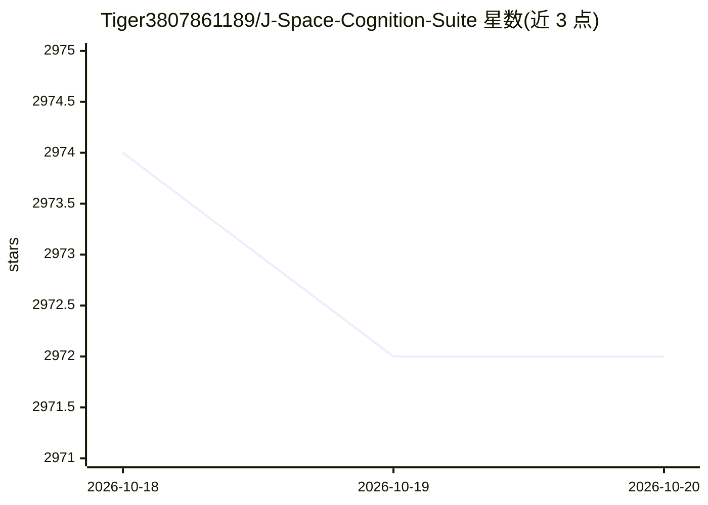

# Tiger3807861189/J-Space-Cognition-Suite

⭐ 2,972 · Python · Apache-2.0 · 推送 2026-09-14 · [GitHub](https://github.com/Tiger3807861189/J-Space-Cognition-Suite) · 个人维护 · 中文 README

**给 agent 宿主的推理时控制技能套件：长任务决策与证据管控**

以单个 SKILL.md 技能形式安装到支持本地技能加载的 agent 宿主（如 Claude 类 agent），提供 13 个共享统一路由入口的模块，覆盖仓库工程、多 agent 协作与验证恢复。核心机制：标准库 Python 控制脚本持久化状态于 .jspace/control.json，维护语义地图与内容清单、按指纹检测过期证据、在缺少必需状态或证据时返回非零阻塞结果；提供 low/medium/high/xhigh 四档操作级别与工作/交付门禁。无 pip 依赖，需 Python 3.10+；宿主需自备工具与 agent。

## 筛选速览

| 维度 | 判定 | 备注 |
|---|---|---|
| AI 角色 | `ai-ecosystem` | LLM/agent 周边工具 |
| 许可风险 | `permissive` | Apache-2.0 |
| 部署形态 | `desktop` | 安装包/桌面程序 |
| 模型依赖 | — | README 未给出锁定关系 |
| 硬件要求 | — | 无带数字的原话,不猜 |
| 安装摩擦 | `low` | 无编译、无系统依赖或容器化 |
| 成熟度 | — | 结构信号不足 |

## 能力要点

- 13 个模块共享一个前提与统一路由入口
- 语义地图 + 指纹检测过期源码与证据
- low/medium/high/xhigh 四档操作级别与工作/交付门禁
- 标准库 Python 实现，无 pip 依赖、无后台服务

## 适用场景

- 在 agent 宿主中执行多文件仓库级工程任务并留存证据
- 协调子 agent 做独立审查与二次复核
- 让长任务的决策持续绑定可验证的源码证据

## 场景标签

`编码 Agent` `多智能体` · 领域:Agent 开发

## 证据(README 行号)

> L7: J-Space is an inference-time workspace and control suite for complex reasoning, repository
> L11: Its thirteen modules share one premise and one routing entry. Standard-library Python
> L17: You need a host that can load a local `SKILL.md` and retrieve its supporting files.

## 星数曲线

2026-10-18 2,974 → 2026-10-20 2,972（-2）

---
*卡片 v1 · prompt 1.4 · 生成 2026-10-20 · 置信度 high · 依据 README sha `0df1e385e031` · [字段定义](../../DATASET.md)*
