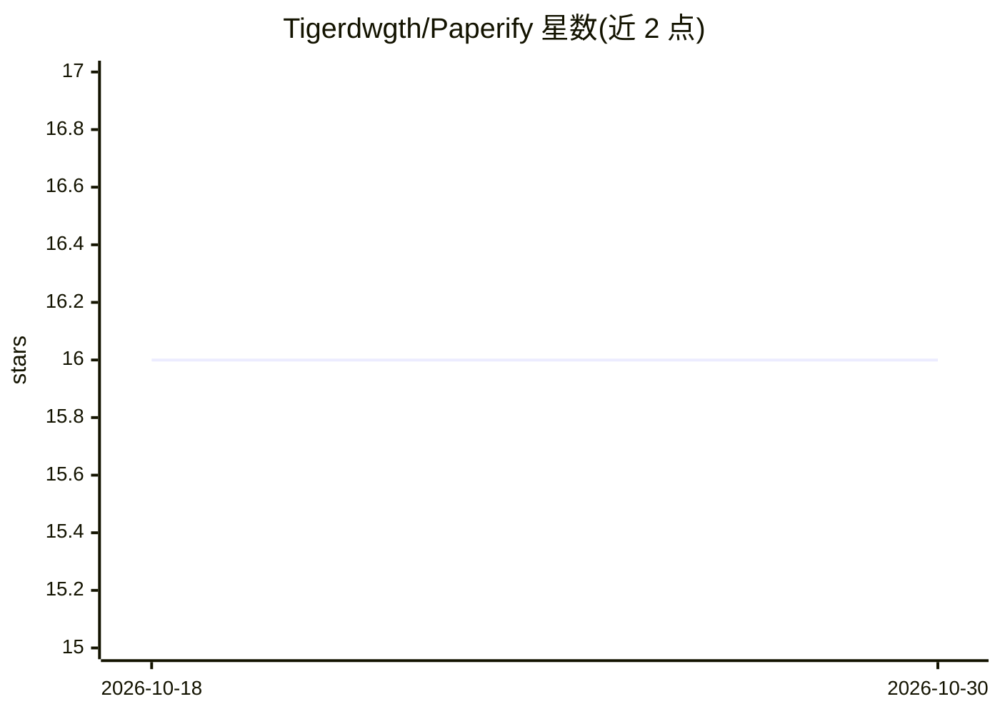

# Tigerdwgth/Paperify

⭐ 16 · Python · 推送 2026-09-23 · [GitHub](https://github.com/Tigerdwgth/Paperify) · 个人维护 · 中文 README

**论文自动转讲解视频并多平台发布的工具，服务于B站/小红书/抖音账号运营**

Paperify（Paper2Video App）是论文转讲解视频的自动化工具：输入 PDF 或 arxiv 链接，提取文本与图片，用 LLM 生成 5 段式讲解脚本，TTS 默认走 DashScope cosyvoice-v2（可路由 Qwen3-TTS / MiniMax），渲染 Ken Burns 动画视频，并可自动生成 Manim 数学动画与 JS/Web 示意动画。产出一键上传 B站/小红书/抖音，含评论自动回复与创作者数据聚合。面向科研内容自媒体（B站账号“具身人机”），Python 源码运行，提供 docker compose 三服务部署。需要手动修补 deepdoctection 的 tesseract 兼容问题。

## 筛选速览

| 维度 | 判定 | 备注 |
|---|---|---|
| AI 角色 | `ai-native` | 本体是模型或模型工具 |
| 许可风险 | `none` | — |
| 部署形态 | `self-host` | docker 或自建部署 |
| 模型依赖 | locked-api |  |
| 硬件要求 | — | 无带数字的原话,不猜 |
| 安装摩擦 | `low` | 无编译、无系统依赖或容器化 |
| 成熟度 | — | 结构信号不足 |

## 能力要点

- PDF→讲解视频全链路：文本/图片提取、LLM 脚本、TTS、视频渲染
- Manim 公式/示意动画 + JS 动画逐帧录制，失败自动降级
- B站/小红书/抖音自动上传、评论 LLM 自动回复、数据聚合
- 内置 paper-search / video-plan / figure-analysis 三组 agent skill CLI

## 适用场景

- 我想把 arxiv 论文自动做成讲解视频发布到 B站和小红书
- 我想批量运营科研内容账号并自动回复评论
- 我有本地 PDF，想直接生成带公式讲解的视频

## 场景标签

`视频生成` `语音合成` · 领域:内容生成

## 证据(README 行号)

> L18: 4. **LLM脚本生成**：5段式结构化视频脚本（opening→intro→method→results），课堂讲解风格。
> L20: 6. **TTS并发合成**：默认 DashScope cosyvoice-v2，可路由到 Qwen3-TTS / MiniMax Speech-2.8-HD 后端（`JSR_TTS_MODEL` / `JSR_TTS_VOICE
> L19: 5. **多平台上传**：B站 / 抖音视频上传 + 小红书图文卡片发布（标题与旁白渲染进图，不再上传视频）。

## 星数曲线

2026-10-18 16 → 2026-10-30 16（+0）

---
*卡片 v1 · prompt 1.4 · 生成 2026-10-30 · 置信度 high · 依据 README sha `54a078fe15e3` · [字段定义](../../DATASET.md)*
