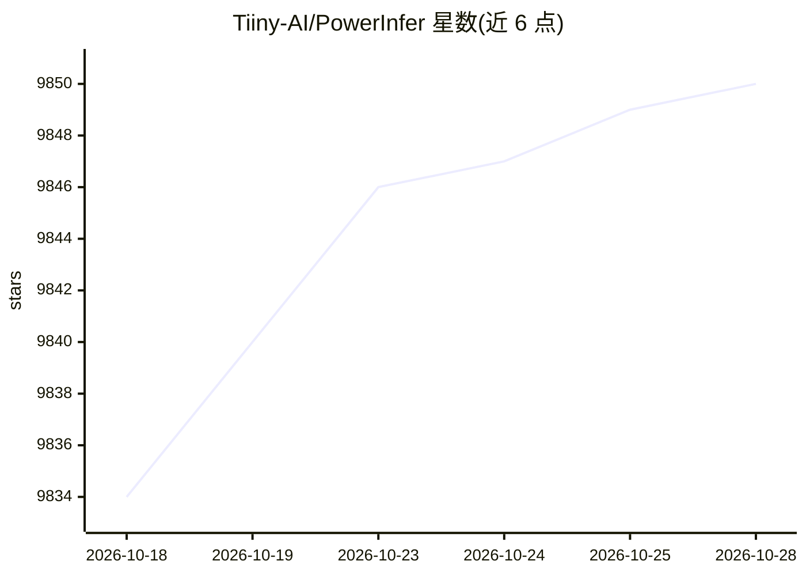

# Tiiny-AI/PowerInfer

⭐ 9,853 · C++ · MIT · 推送 2026-05-11 · [GitHub](https://github.com/Tiiny-AI/PowerInfer) · 组织维护 · 中文 README

**消费级单 GPU 上的本地 LLM 高速推理引擎**

面向个人电脑本地部署的 CPU/GPU 混合 LLM 推理引擎，核心机制是利用神经元激活的幂律分布：高频激活的 hot 神经元预加载到 GPU，cold 神经元在 CPU 计算，配合自适应预测器与神经元感知稀疏算子降低显存需求。支持 Linux/Windows（x86-64 AVX2，可配 NVIDIA/AMD GPU）与 macOS（仅 CPU，优化有限）。通过 CMake 从源码构建，模型以 PowerInfer GGUF 格式从 Hugging Face 获取或用 convert.py 转换；兼容 ReLU 稀疏模型族（ReluLLaMA/ProSparse/Bamboo/Falcon）。限制：macOS 未优化，稠密模式支持有限。

## 筛选速览

| 维度 | 判定 | 备注 |
|---|---|---|
| AI 角色 | `ai-ecosystem` | LLM/agent 周边工具 |
| 许可风险 | `permissive` | MIT |
| 部署形态 | `desktop` | 安装包/桌面程序 |
| 模型依赖 | local-ok | 支持本地模型 |
| 硬件要求 | — | 无带数字的原话,不猜 |
| 安装摩擦 | `medium` | 含编译或系统依赖之一 |
| 成熟度 | — | 结构信号不足 |

## 能力要点

- 基于激活局部性的 GPU-CPU 混合推理，hot/cold 神经元分层放置
- 支持 NVIDIA(CUDA)/AMD(ROCm)/纯 CPU 三种构建路径
- PowerInfer GGUF 格式模型转换（convert.py）与稠密 GGUF 转换（convert-dense.py）
- 兼容 ReLU 稀疏模型：ReluLLaMA-2、ProSparse、Bamboo-7B、Falcon-40B 等

## 适用场景

- 在单张消费级显卡的 PC 上本地运行 40B 级 LLM
- 显存受限时用 --vram-budget 限制 GPU 显存做混合推理
- 将 ReLU 稀疏化模型权重转换为 PowerInfer GGUF 并推理

## 场景标签

`推理引擎` · 领域:训练与推理

## 证据(README 行号)

> L42: We introduce PowerInfer, a high-speed Large Language Model (LLM) inference engine on a personal computer (PC)
> L48: PowerInfer exploits such an insight to design a GPU-CPU hybrid inference engine:

## 星数曲线

2026-10-18 9,834 → 2026-10-28 9,850（+16）

---
*卡片 v1 · prompt 1.4 · 生成 2026-10-20 · 置信度 mid · 依据 README sha `6ef44555fc3f` · [字段定义](../../DATASET.md)*
