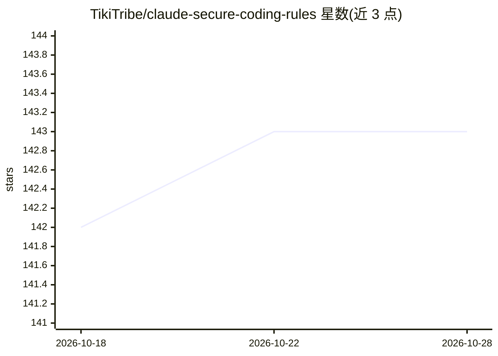

# TikiTribe/claude-secure-coding-rules

⭐ 143 · Python · MIT · 推送 2026-05-26 · [GitHub](https://github.com/TikiTribe/claude-secure-coding-rules) · 组织维护

**供 Claude Code 加载的安全编码规则集：默认生成安全代码**

一套以 Markdown 规则文件（CLAUDE.md 格式）形式提供的开源安全规则库：复制到项目后由 Claude Code 在代码生成时自动应用，按 strict/warning/advisory 三级执行——拒绝生成违反 strict 规则的代码、对 warning 级问题提示替代方案。内容覆盖 OWASP Top 10 2025、OWASP MCP Top 10、NIST AI RMF、MITRE ATLAS 等标准，含 100+ 规则集，面向 12 种语言、后端/前端框架、AI/ML 框架与 RAG 工具。附 pytest 测试框架（集成 Semgrep/Bandit）验证规则格式与示例。规则文件本身为纯文本，无需编译。

## 筛选速览

| 维度 | 判定 | 备注 |
|---|---|---|
| AI 角色 | `ai-knowledge` | 知识聚合/清单类 |
| 许可风险 | `permissive` | MIT |
| 部署形态 | `library` | 以包/库形式分发 |
| 模型依赖 | locked-api |  |
| 硬件要求 | — | 无带数字的原话,不猜 |
| 安装摩擦 | `low` | 无编译、无系统依赖或容器化 |
| 成熟度 | — | 结构信号不足 |

## 能力要点

- strict/warning/advisory 三级执行模式，strict 级拒绝生成违规代码
- 覆盖 OWASP Top 10 2025、OWASP MCP Top 10、NIST AI RMF、MITRE ATLAS 等标准
- 100+ 规则集覆盖 12 种语言、5 后端框架、11 个 AI/ML 框架、51 个 RAG 工具
- 规则统一采用 Do/Don't/Why/Refs 格式并附 CWE/OWASP 引用，带 pytest+Semgrep+Bandit 测试框架

## 适用场景

- 让 Claude Code 在编码时自动拒绝生成 SQL 注入等漏洞模式
- 为 AI/ML 与 agentic AI 项目配置 NIST AI RMF/MITRE ATLAS 安全规则
- 为 MCP Server 开发与 RAG 应用按技术栈组合安全规则

## 场景标签

`网络安全` `提示工程` · 领域:Agent 开发

## 证据(README 行号)

> L3: **Open-source security rules that guide Claude Code to generate secure code by default.**
> L10: This repository provides comprehensive security rules for Claude Code, covering web applications, AI/ML systems, an
> L18: - **100+ Rule Sets** - Covering 12 languages, 5 backend frameworks, 11 AI/ML frameworks, 5 frontend frameworks, 51 

## 星数曲线

2026-10-18 142 → 2026-10-28 143（+1）

---
*卡片 v1 · prompt 1.4 · 生成 2026-10-23 · 置信度 mid · 依据 README sha `65c0ca5e03fa` · [字段定义](../../DATASET.md)*
