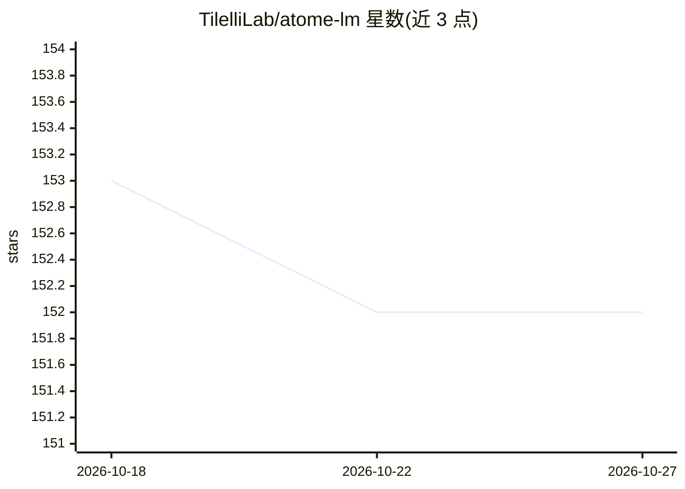

# TilelliLab/atome-lm

⭐ 152 · Python · Apache-2.0 · 推送 2026-07-08 · [GitHub](https://github.com/TilelliLab/atome-lm) · [官网](https://atomelm.com) · 组织维护 · 中文 README

**微控制器级三值微型语言模型：训练到 C99 部署的完整工具包**

面向 cents 级硬件的路由三值微型语言模型参考实现：60K 默认参数（可扩到约 600K），采用 BitNet b1.58 式三值权重、三路径混合块（局部卷积 + 对角 SSM + top-k 稀疏注意力）与字节级分词器，提供训练 → 三值导出 → base-3 打包 → C99 推理的完整路径，Python 与 C 引擎间位精确一致由测试保证。含 944K 检查点，QEMU Cortex-M3 与 ESP32-WROOM-32 真机演示（约 1 tok/s，离线）。README 明示 944K 参数以上被 FP32 基线反超，模型非通用聊天用途。

## 筛选速览

| 维度 | 判定 | 备注 |
|---|---|---|
| AI 角色 | `ai-native` | 本体是模型或模型工具 |
| 许可风险 | `permissive` | Apache-2.0 |
| 部署形态 | `library` | 以包/库形式分发 |
| 模型依赖 | — | README 未给出锁定关系 |
| 硬件要求 | `cpu-ok` | |
| 安装摩擦 | `low` | 无编译、无系统依赖或容器化 |
| 成熟度 | `idea` | |

## 能力要点

- 三值权重 + 每词元路由的三路径块 + 字节分词器的完整训练/导出/C99 推理工具包
- Python ↔ C99 ↔ Cortex-M3(QEMU) 位精确一致性由测试强制
- ESP32-WROOM-32 真机离线运行 944K 检查点（约 1 tok/s，含预编译固件与一键烧录）
- 默认配置约 20 KB flash 占用，CPU 上约 30 分钟可训练演示检查点

## 适用场景

- 在 ESP32/STM32/RP2040 等微控制器上离线运行窄域文本生成或问答
- 研究亚 1M 参数、MCU 级预算下的三值语言模型
- 复现训练→导出→嵌入式部署的完整流程并做位精确校验

## 场景标签

`模型量化` `模型训练` · 领域:训练与推理

## 证据(README 行号)

> L10: > A reference implementation of a routed-ternary tiny language model with a
> L21: **The contribution is integration, not architecture**: a complete train →
> L39: physical **ESP32-WROOM-32** — coherent text, fully offline, ~1 tok/s — see

## 星数曲线

2026-10-18 153 → 2026-10-27 152（-1）

---
*卡片 v1 · prompt 1.4 · 生成 2026-10-22 · 置信度 high · 依据 README sha `af817ad188d7` · [字段定义](../../DATASET.md)*
