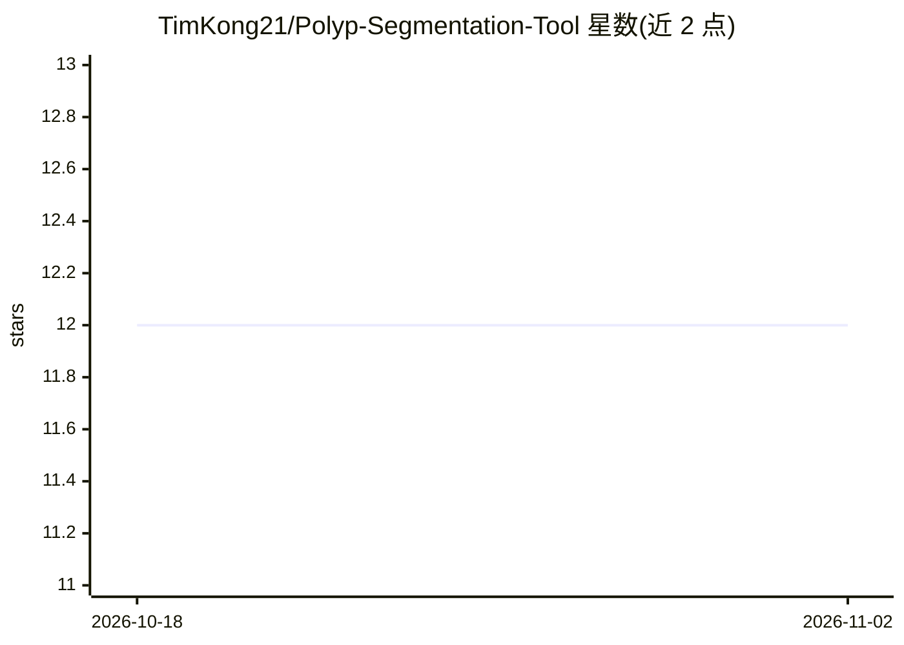

# TimKong21/Polyp-Segmentation-Tool

⭐ 12 · Jupyter Notebook · MIT · 推送 2026-07-31 · [GitHub](https://github.com/TimKong21/Polyp-Segmentation-Tool) · [官网](https://polyp-segmentation-tool.streamlit.app/) · 个人维护

**结肠镜图像息肉分割工具：U-Net 生成掩膜**

基于 Streamlit 的交互式网页应用：用户上传 JPG/JPEG 结肠镜图像，由在 Kvasir-SEG 数据集上训练的 U-Net 模型生成像素级分割掩膜，掩膜与原图并排显示，支持批量处理与 ZIP 打包下载结果。模型存储于 AWS S3 按需动态加载，亦可通过附带 notebook 在本地或 Google Colab 自行训练。README 声明为作品集与研究项目，非临床设备，不可用于诊断或治疗决策。

## 筛选速览

| 维度 | 判定 | 备注 |
|---|---|---|
| AI 角色 | `ai-native` | 本体是模型或模型工具 |
| 许可风险 | `permissive` | MIT |
| 部署形态 | `library` | 以包/库形式分发 |
| 模型依赖 | — | README 未给出锁定关系 |
| 硬件要求 | — | 无带数字的原话,不猜 |
| 安装摩擦 | `low` | 无编译、无系统依赖或容器化 |
| 成熟度 | — | 结构信号不足 |

## 能力要点

- U-Net 架构执行像素级医学图像分割
- 支持 JPG/JPEG 上传的批量分割与 ZIP 下载
- 模型存于 AWS S3 按需加载，也可用 notebook 自行训练
- 包含预处理与数据增强流水线

## 适用场景

- 上传结肠镜图像批量生成息肉分割掩膜
- 在 Kvasir-SEG 或自有数据上训练 U-Net 模型
- 作为医学图像分割的教学与作品集演示项目

## 场景标签

`目标检测` · 领域:感知与多模态

## 证据(README 行号)

> L7: Polyp Segmentation Tool is an interactive Streamlit application that produces segmentation masks for colonoscopy ima
> L9: > This is a portfolio and research project, not a clinical device. It is not intended for diagnosis, treatment decis

## 星数曲线

2026-10-18 12 → 2026-11-02 12（+0）

---
*卡片 v1 · prompt 1.4 · 生成 2026-11-01 · 置信度 high · 依据 README sha `833087d501aa` · [字段定义](../../DATASET.md)*
