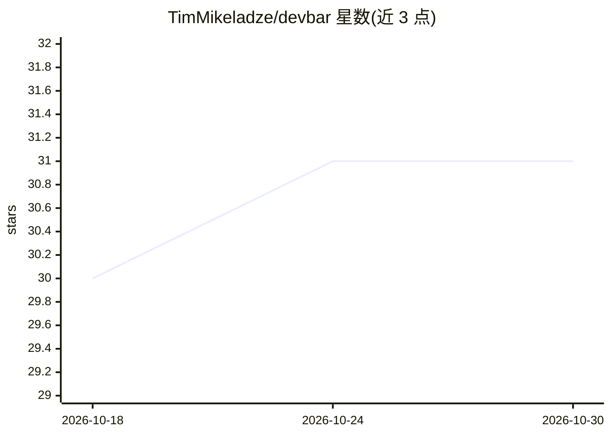

# TimMikeladze/devbar

⭐ 31 · TypeScript · MIT · 推送 2026-10-01 · [GitHub](https://github.com/TimMikeladze/devbar) · [官网](https://devbar.sh) · 个人维护

**给前端开发者的网页标注工具栏：采集 UI 信息并生成交给 AI agent 的提示**

可挂载在任意网站的 React 工具栏：通过 Select/Marker/Draw/Capture/Record 工具在页面上标注，采集元素选择器、计算样式、React 组件树路径与截图，连同任务描述导出为 markdown 提示、JSON、HTML 或 PDF。内置本地 CLI 服务器，可将报告分发给项目中的 agent CLI（claude/codex/opencode）自动执行，或通过 MCP 让已打开的 agent 会话检查、截图当前页面。另提供 Manifest V3 Chrome 扩展，无需修改站点代码即可启用。仅限 localhost 页面与本地回环运行。

## 筛选速览

| 维度 | 判定 | 备注 |
|---|---|---|
| AI 角色 | `ai-ecosystem` | LLM/agent 周边工具 |
| 许可风险 | `permissive` | MIT |
| 部署形态 | `None` |  |
| 模型依赖 | — | README 未给出锁定关系 |
| 硬件要求 | — | 无带数字的原话,不猜 |
| 安装摩擦 | `low` | 无编译、无系统依赖或容器化 |
| 成熟度 | — | 结构信号不足 |

## 能力要点

- 元素选择器、React 组件树、计算样式与截图采集并导出为 agent 提示
- 报告可自动分发给 claude/codex/opencode agent CLI，或经 MCP 供已有会话拉取
- Manifest V3 Chrome 扩展可在任意页面注入工具栏，无需改站点代码
- 提供 .md/.json/.html/.pdf 四种导出格式

## 适用场景

- 在网页上圈点 UI 问题并一键生成给 AI agent 修复的提示
- 把 UI 缺陷整理成可附加到工单的独立 HTML/PDF 报告
- 让已打开的 agent 会话通过 MCP 实时检查和截图我正在看的页面

## 场景标签

`提示工程` · 领域:Agent 开发

## 证据(README 行号)

> L3: Drop-in toolbar for any website. Annotate the UI and capture selectors, computed
> L4: styles, React component trees, and screenshots as an agent-ready prompt.
> L102: - **Push** — the report is handed to an agent CLI (`claude`, `codex`, or

## 星数曲线

2026-10-18 30 → 2026-10-30 31（+1）

---
*卡片 v1 · prompt 1.4 · 生成 2026-10-26 · 置信度 high · 依据 README sha `cdaab4036ec2` · [字段定义](../../DATASET.md)*
