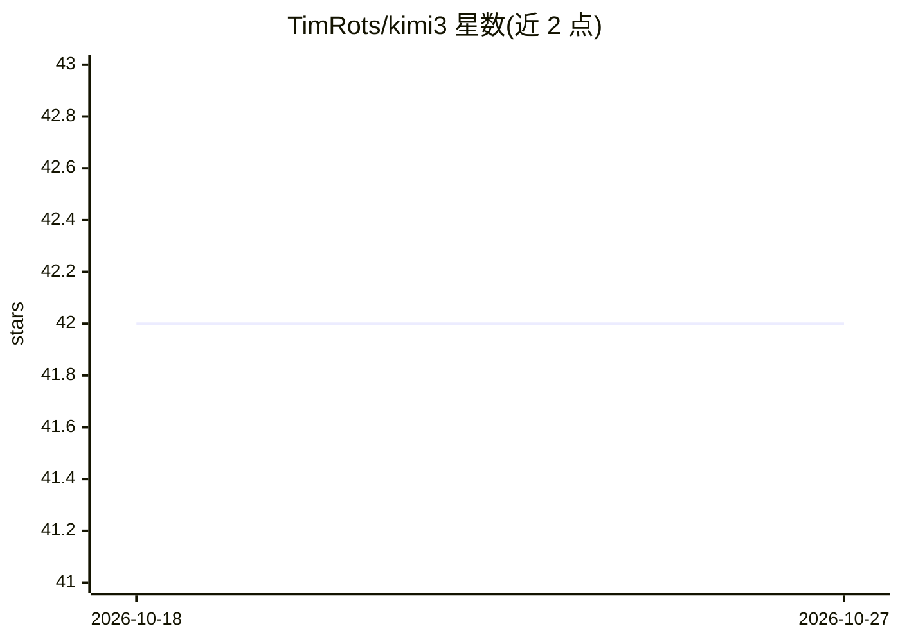

# TimRots/kimi3

⭐ 42 · Python · AGPL-3.0 · 推送 2026-08-09 · [GitHub](https://github.com/TimRots/kimi3) · 个人维护

**Kimi K3 架构的从零 PyTorch 复现实现，CPU 可运行验证**

独立实现论文《Kimi K3: Open Frontier Intelligence》(arXiv:2607.24653v1) 描述的架构：KDA 线性注意力、Gated MLA（全程 NoPE）、Stable LatentMoE、MoonViT-V2 视觉塔，以及预训练、后训练与基础设施组件。参数量复现论文 Table 1（2.778T/104.1B 激活）。同一代码路径通过配置覆盖 19.75M nano 到 2.8T 规模；测试套件、参数审计与 demo 均可在 CPU 完成，GPU 可选加速。集群级训练、多节点启动器、SFT/RL 入口、MoE all-to-all 等明确未实现；仓库不含训练权重。面向研究架构实现与验证场景。

## 筛选速览

| 维度 | 判定 | 备注 |
|---|---|---|
| AI 角色 | `ai-native` | 本体是模型或模型工具 |
| 许可风险 | `viral` | AGPL-3.0 |
| 部署形态 | `library` | 以包/库形式分发 |
| 模型依赖 | — | README 未给出锁定关系 |
| 硬件要求 | — | 无带数字的原话,不猜 |
| 安装摩擦 | `medium` | 含编译或系统依赖之一 |
| 成熟度 | — | 结构信号不足 |

## 能力要点

- KDA/NoPE/LatentMoE/Block AttnRes 等论文组件的 PyTorch 实现
- 参数量复现论文 Table 1 至 2.778T（0.09% 内）
- 无 GPU 即可运行：322 个测试、参数审计与五个 demo 均可在 CPU 完成
- docs/PAPER_MAP.md 逐节映射论文组件的实现与测试状态

## 适用场景

- 在笔记本 CPU 上验证并学习 K3 架构各组件的行为
- 复现参数审计与等价性验证套件（scripts/verify.sh）
- 以 nano/micro 配置做小规模训练与生成实验

## 场景标签

 · 领域:大模型/架构研究实现

## 证据(README 行号)

> L3: An implementation of the architecture, pre-training protocol, systems co-designs,
> L8: code path runs a 20M-parameter model on a laptop CPU and describes the paper's

## 星数曲线

2026-10-18 42 → 2026-10-27 42（+0）

---
*卡片 v1 · prompt 1.4 · 生成 2026-10-25 · 置信度 high · 依据 README sha `108cde04652f` · [字段定义](../../DATASET.md)*
