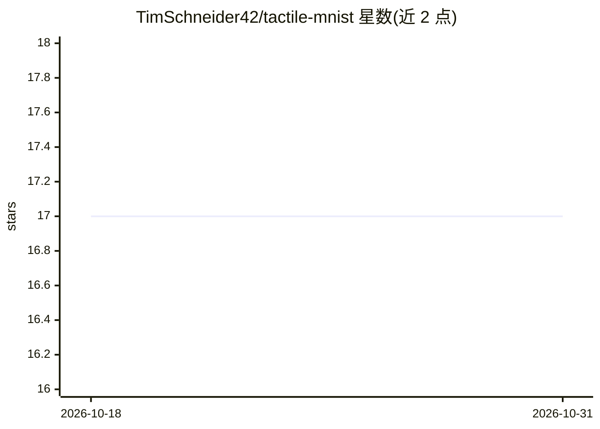

# TimSchneider42/tactile-mnist

⭐ 17 · Python · MIT · 推送 2026-10-28 · [GitHub](https://github.com/TimSchneider42/tactile-mnist) · [官网](https://timschneider42.github.io/tactile-mnist/) · 个人维护

**触觉主动感知强化学习基准：11 个仿真任务与触觉数据集**

面向基于学习的主动感知算法的基准套件：以 ap_gym（Gymnasium 风格）环境实现 11 个仿真触觉任务，智能体控制仿真 GelSight Mini 传感器完成分类、计数、位姿、质心与体积估计等预测，供公平比较主动触觉感知方法。另提供 3D 网格数据集、Taxim 合成触觉图像数据集及 Franka 机器人采集的真实触觉 MNIST 数据集，并附带基线学习曲线 CSV。通过 pip 安装，交互环境需选择 jax 或 torch 等可选依赖。

## 筛选速览

| 维度 | 判定 | 备注 |
|---|---|---|
| AI 角色 | `ai-ecosystem` | LLM/agent 周边工具 |
| 许可风险 | `permissive` | MIT |
| 部署形态 | `library` | 以包/库形式分发 |
| 模型依赖 | — | README 未给出锁定关系 |
| 硬件要求 | — | 无带数字的原话,不猜 |
| 安装摩擦 | `medium` | 含编译或系统依赖之一 |
| 成熟度 | — | 结构信号不足 |

## 能力要点

- 11 个 ap_gym 仿真触觉感知任务（分类/计数/位姿/质心/体积）
- 含真实（Franka 机器人采集）与合成触觉图像数据集
- 附基线学习曲线 CSV 数据（5 seeds）
- pip 安装，JAX/PyTorch 可选后端

## 适用场景

- 评估与比较主动触觉感知强化学习算法
- 训练智能体通过触觉探索完成物体分类或位姿估计
- 获取触觉图像数据集用于触觉感知研究

## 场景标签

`模型评测` · 领域:评测与运维

## 证据(README 行号)

> L58: Tactile MNIST is a benchmark for learning-based active perception algorithms.
> L63: Tactile MNIST implements each task as an ap_gym environment and is, thus, very straightforward to set up and use.

## 星数曲线

2026-10-18 17 → 2026-10-31 17（+0）

---
*卡片 v1 · prompt 1.4 · 生成 2026-10-29 · 置信度 high · 依据 README sha `1ee96d6dc591` · [字段定义](../../DATASET.md)*
