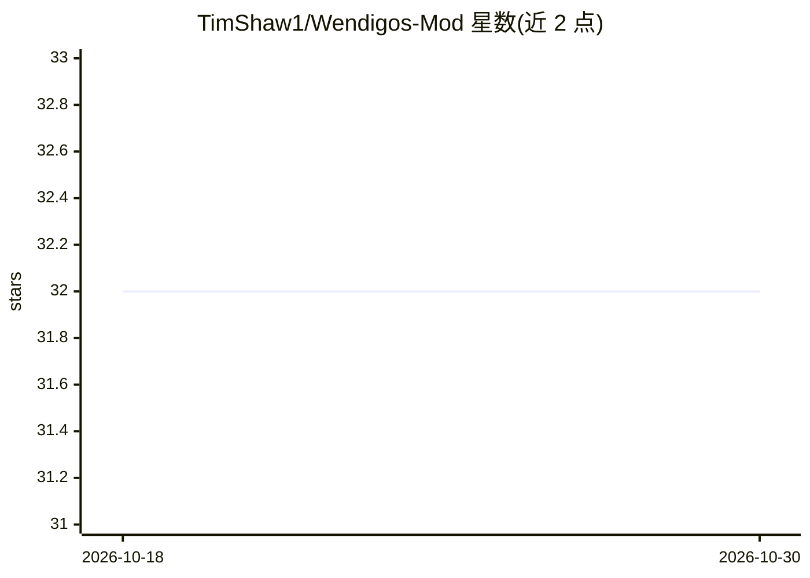

# TimShaw1/Wendigos-Mod

⭐ 32 · C# · 推送 2026-03-18 · [GitHub](https://github.com/TimShaw1/Wendigos-Mod) · [官网](https://www.youtube.com/@Tim-Shaw) · 个人维护

**Lethal Company 游戏模组：让怪物克隆玩家语音进行对话**

Lethal Company 的游戏模组：游戏内怪物 Masked 会收集玩家语音片段、自动转录并调用聊天 API 生成回复，再通过 TTS 以玩家克隆的语音说出，使怪物能与玩家实时对话、模仿队友语音迷惑玩家。需每位玩家安装本模组；非实时模式可使用免费的 Gemini 聊天 API 与 Azure STT，实时模式为实验性功能，需 Elevenlabs 订阅。基于作者自己的 AI 服务框架 VoiceBox 接入多种 AI 服务。

## 筛选速览

| 维度 | 判定 | 备注 |
|---|---|---|
| AI 角色 | `ai-enhanced` | 去掉 AI 部分产品仍成立 |
| 许可风险 | `none` | — |
| 部署形态 | `None` |  |
| 模型依赖 | — | README 未给出锁定关系 |
| 硬件要求 | — | 无带数字的原话,不猜 |
| 安装摩擦 | `low` | 无编译、无系统依赖或容器化 |
| 成熟度 | `idea` | |

## 能力要点

- 实时 AI 对话：怪物对玩家语音生成回复并克隆语音播放
- 自动语音片段收集与转录，支持无实时模式的智能回复
- 可选自动语音克隆，无需提前克隆
- 房主配置同步（含 API key）简化多人设置

## 适用场景

- 多人游戏中让怪物伪装队友语音制造迷惑
- 为 Lethal Company 添加 AI 驱动的社交恐怖玩法

## 场景标签

`语音合成` · 领域:内容生成

## 证据(README 行号)

> L14: - Real-time AI generated responses to players, allowing the masked to hold full conversations with players.
> L16: - Optional automatic voice cloning (no more cloning in advance!).

## 星数曲线

2026-10-18 32 → 2026-10-30 32（+0）

---
*卡片 v1 · prompt 1.4 · 生成 2026-10-26 · 置信度 high · 依据 README sha `cd360f093b6b` · [字段定义](../../DATASET.md)*
