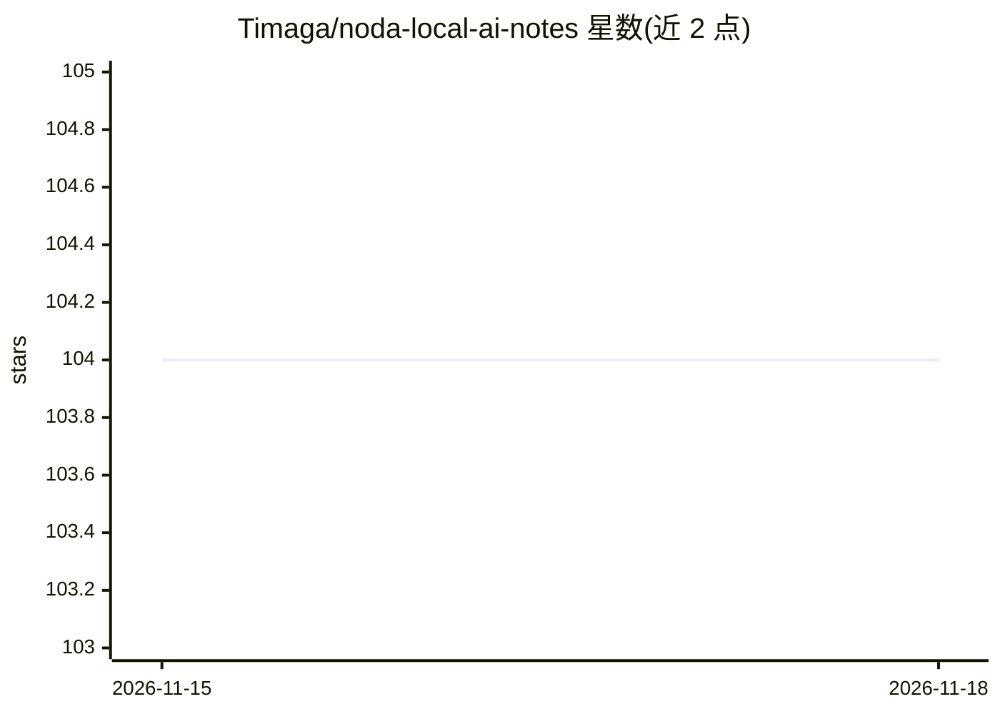

# Timaga/noda-local-ai-notes

⭐ 104 · JavaScript · NOASSERTION · 推送 2026-11-14 · [GitHub](https://github.com/Timaga/noda-local-ai-notes) · 个人维护 · 中文 README

**Windows 本地 AI 笔记应用：Markdown 知识库+图谱+语义搜索**

面向 Windows x64 用户的 local-first AI 笔记应用：笔记以 Markdown 文件保存在用户自选的项目文件夹中，功能覆盖快速采集、Markdown 编辑、可选 AI 标题与标签、知识图谱、语义搜索及带来源引用的本地聊天。笔记处理与推理在本机运行，依赖本地 Python 与 Qdrant 组件，首次设置需联网下载模型（语义搜索模型约 1.1 GB）。要求 AVX2 处理器，16 GB 内存为推荐起点；代码采用 PolyForm 非商业许可，不支持商用与微调。

## 筛选速览

| 维度 | 判定 | 备注 |
|---|---|---|
| AI 角色 | `ai-native` | 本体是模型或模型工具 |
| 许可风险 | `none` | NOASSERTION |
| 部署形态 | `desktop` | 安装包/桌面程序 |
| 模型依赖 | — | README 未给出锁定关系 |
| 硬件要求 | — | 无带数字的原话,不猜 |
| 安装摩擦 | `low` | 无编译、无系统依赖或容器化 |
| 成熟度 | — | 结构信号不足 |

## 能力要点

- 笔记保存为本地 Markdown 文件，项目文件夹与配置数据分离
- 本地推理：语义搜索与带引用来源的笔记问答，无需托管模型 API
- 知识图谱展示保存的连接与反向链接，AI 建议为可编辑元数据
- 支持 10 种界面语言（含简体中文），笔记处理配置支持俄语与英语

## 适用场景

- 把散落的 Markdown 笔记组织成可搜索、可问答的个人知识库
- 通过知识图谱和反向链接查看笔记之间的关联
- 在不上传笔记到云端的前提下做语义搜索与本地问答

## 场景标签

`知识库管理` `语义搜索` `知识图谱` `文档问答` · 领域:知识与检索

## 证据(README 行号)

> L15: Noda is a local-first AI note-taking app for Windows that keeps your personal knowledge base in Markdown files. It 
> L17: The app runs note processing and chat on your computer using installed models. Initial setup and model downloads re

## 星数曲线

2026-11-15 104 → 2026-11-18 104（+0）

---
*卡片 v1 · prompt 1.4 · 生成 2026-11-17 · 置信度 high · 依据 README sha `cb9e351f1489` · [字段定义](../../DATASET.md)*
