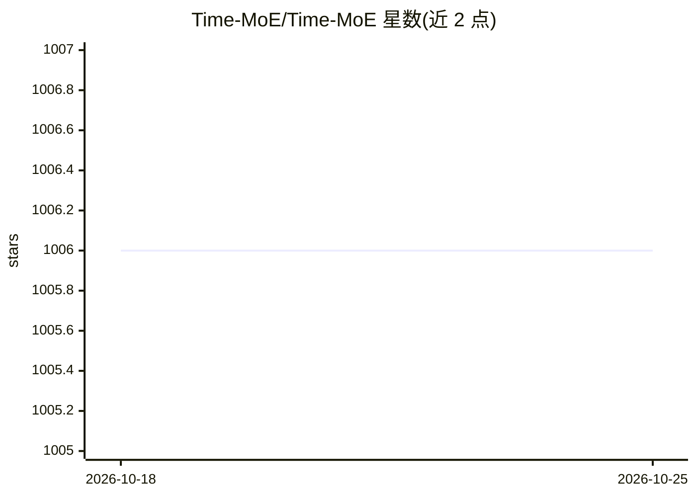

# Time-MoE/Time-MoE

⭐ 1,006 · Python · Apache-2.0 · 推送 2026-03-21 · [GitHub](https://github.com/Time-MoE/Time-MoE) · [官网](https://arxiv.org/abs/2409.16040) · 组织维护 · 中文 README

**十亿参数级时序基础模型（MoE 架构）官方实现，用于时序预测**

ICLR 2025 Spotlight 论文 Time-MoE 的官方代码：提供 decoder-only、混合专家（MoE）架构的时序基础模型，自回归方式运行，支持任意预测长度、上下文最长 4096（建议上下文加预测长度不超过 4096）。模型分 base 与 large 两档（最大 2.4B 参数），已在 Hugging Face 发布，配套开源训练数据集 Time-300B（超 3000 亿时间点）。支持 Python 加载推理、基准评测与单机/多机多卡微调或从头训练；需 Python 3.10+、transformers 4.40.1，可选用 flash-attn 加速。协变量支持与时序分类为 TODO 未实现。

## 筛选速览

| 维度 | 判定 | 备注 |
|---|---|---|
| AI 角色 | `ai-native` | 本体是模型或模型工具 |
| 许可风险 | `permissive` | Apache-2.0 |
| 部署形态 | `library` | 以包/库形式分发 |
| 模型依赖 | — | README 未给出锁定关系 |
| 硬件要求 | — | 无带数字的原话,不猜 |
| 安装摩擦 | `medium` | 含编译或系统依赖之一 |
| 成熟度 | — | 结构信号不足 |

## 能力要点

- MoE 架构时序基础模型，最大 2.4B 参数，自回归任意预测长度
- 配套 Time-300B 开源数据集（>300B 时间点、9+ 领域）
- 支持 CPU/单节点多卡/多节点多卡微调与从头训练
- base 与 large 模型已发布于 Hugging Face

## 适用场景

- 在我自己的时序数据上做零样本或微调预测
- 在 ETT 等基准上评测时序基础模型
- 基于 Time-300B 数据集训练或扩展时序模型

## 场景标签

 · 领域:时间序列机器学习/科研

## 证据(README 行号)

> L6: > 1️⃣ Time-MoE is the **first work** to scale time series foundation models up to **2.4 billion** parameters, traine
> L31: Time-MoE comprises a family of decoder-only time series foundation models with a mixture-of-experts architecture,
> L32: designed to operate in an auto-regressive manner, enabling universal forecasting with arbitrary prediction horizons

## 星数曲线

2026-10-18 1,006 → 2026-10-25 1,006（+0）

---
*卡片 v1 · prompt 1.4 · 生成 2026-10-21 · 置信度 high · 依据 README sha `3654b49f20c8` · [字段定义](../../DATASET.md)*
