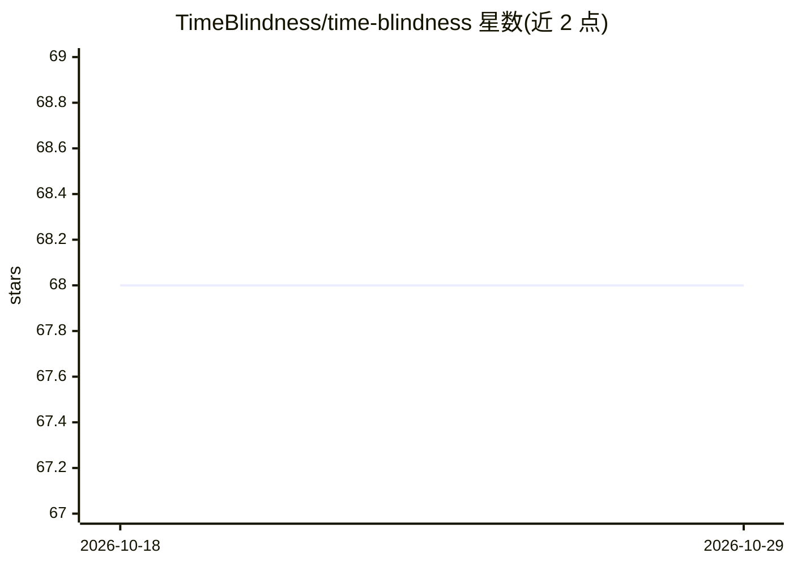

# TimeBlindness/time-blindness

⭐ 68 · Python · MIT · 推送 2026-01-28 · [GitHub](https://github.com/TimeBlindness/time-blindness) · [官网](https://timeblindness.github.io/) · 组织维护

**评测视频语言模型纯时序理解能力的基准数据集 SpookyBench**

CVPR 论文配套的基准数据集与评测代码：451 个视频仅通过噪声帧的时序序列编码信息（单词/物体/动态场景/形状四类），用于隔离评测 Video-VLM 的纯时序理解能力。论文报告人类准确率 98%，而 15+ 个受测模型（GPT-4o、Gemini、Qwen、InternVL 等）均为 0%。提供 wget 下载 Hugging Face 数据集、各模型评测脚本与人类评测 Web 界面，部分模型评测指引指向各自原仓库，批量动画生成代码为待办项。

## 筛选速览

| 维度 | 判定 | 备注 |
|---|---|---|
| AI 角色 | `ai-knowledge` | 知识聚合/清单类 |
| 许可风险 | `permissive` | MIT |
| 部署形态 | `library` | 以包/库形式分发 |
| 模型依赖 | — | README 未给出锁定关系 |
| 硬件要求 | — | 无带数字的原话,不猜 |
| 安装摩擦 | `low` | 无编译、无系统依赖或容器化 |
| 成熟度 | — | 结构信号不足 |

## 能力要点

- 451 个视频、4 类纯时序编码模式，单帧呈噪声、时序上显现内容
- 对向运动（前景/背景反向）的时序编码框架与 SNR/时序一致性等信号指标
- 附带 GPT-4o/Gemini/Qwen/InternVL 等多模型评测脚本与人类评测界面
- 提供 Qwen 模型微调数据 json

## 适用场景

- 评测我的视频理解模型在纯时序任务上的表现
- 研究 Video-VLM 的时序感知机制缺陷
- 用该数据集微调或诊断时序理解模型

## 场景标签

`模型评测` · 领域:评测与运维

## 证据(README 行号)

> L23: We introduce **👻 SpookyBench**, the first benchmark designed to isolate and evaluate pure temporal understanding by
> L27: ✅ **451 carefully crafted videos** across **4 distinct categories** (Words, Shapes, Objects, Dynamic Scenes)
> L29: ✅ **Comprehensive evaluation**: 15+ state-of-the-art models tested including GPT-4o, Gemini, Qwen-VL

## 星数曲线

2026-10-18 68 → 2026-10-29 68（+0）

---
*卡片 v1 · prompt 1.4 · 生成 2026-10-24 · 置信度 mid · 依据 README sha `9cb551694c75` · [字段定义](../../DATASET.md)*
