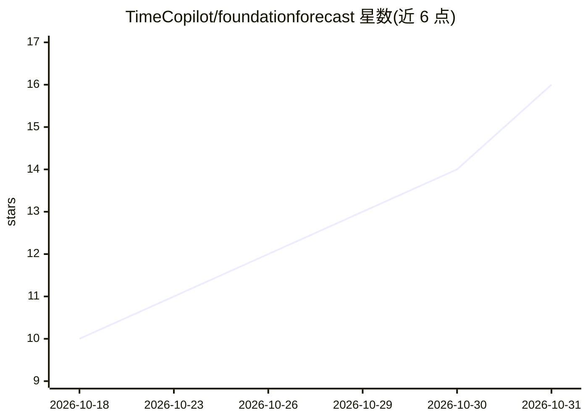

# TimeCopilot/foundationforecast

⭐ 16 · Python · Apache-2.0 · 推送 2026-10-29 · [GitHub](https://github.com/TimeCopilot/foundationforecast) · [官网](https://docs.timecopilot.dev/foundationforecast) · 组织维护

**统一 API 调用多家时间序列基础模型的 Python 库**

由 TimeCopilot 团队开发的 Python 库：用一个 FoundationForecast 类和统一数据格式（unique_id/ds/y 三列），对 Chronos、TimesFM、TimeGPT、Timestral、TimeH2O 等 15 个时间序列基础模型执行 forecast、cross_validation 与 detect_anomalies，支持预测区间与已知未来外生变量（X_df，仅限指定 checkpoint）。可在 Hugging Face repo_id 或本地 checkpoint 间切换，GPU 可用时自动使用。各模型权重许可差异在 README 中逐条说明，库本身 Apache-2.0；需 Python 3.10+，部分模型有额外版本要求。

## 筛选速览

| 维度 | 判定 | 备注 |
|---|---|---|
| AI 角色 | `ai-native` | 本体是模型或模型工具 |
| 许可风险 | `permissive` | Apache-2.0 |
| 部署形态 | `library` | 以包/库形式分发 |
| 模型依赖 | — | README 未给出锁定关系 |
| 硬件要求 | — | 无带数字的原话,不猜 |
| 安装摩擦 | `low` | 无编译、无系统依赖或容器化 |
| 成熟度 | — | 结构信号不足 |

## 能力要点

- 统一 API 覆盖 15 个时间序列基础模型的预测/交叉验证/异常检测
- 已知未来外生变量 X_df 原生支持（Chronos-2、TimesFM-3、TimeGPT 等指定 checkpoint）
- GPU 可用时自动运行，无需按模型配置设备
- 包装器在 CI 中对照 GIFT-Eval / fev-bench 官方提交做回归测试

## 适用场景

- 用同一套代码在不同预测模型间切换与对比
- 时间序列预测任务中加入节假日、价格等已知未来协变量
- 对模型权重许可有要求的场景，按许可表选择可商用的 checkpoint

## 场景标签

`模型网关` · 领域:Agent 开发

## 证据(README 行号)

> L21: **FoundationForecast** removes that friction: one `FoundationForecast` class, one data format, and the same methods
> L47: Every model supports **forecast**, **cross-validation**, and **anomaly detection** through the same API. **Interval

## 星数曲线

2026-10-18 10 → 2026-10-31 16（+6）

---
*卡片 v1 · prompt 1.4 · 生成 2026-10-30 · 置信度 high · 依据 README sha `8154af0fc6de` · [字段定义](../../DATASET.md)*
