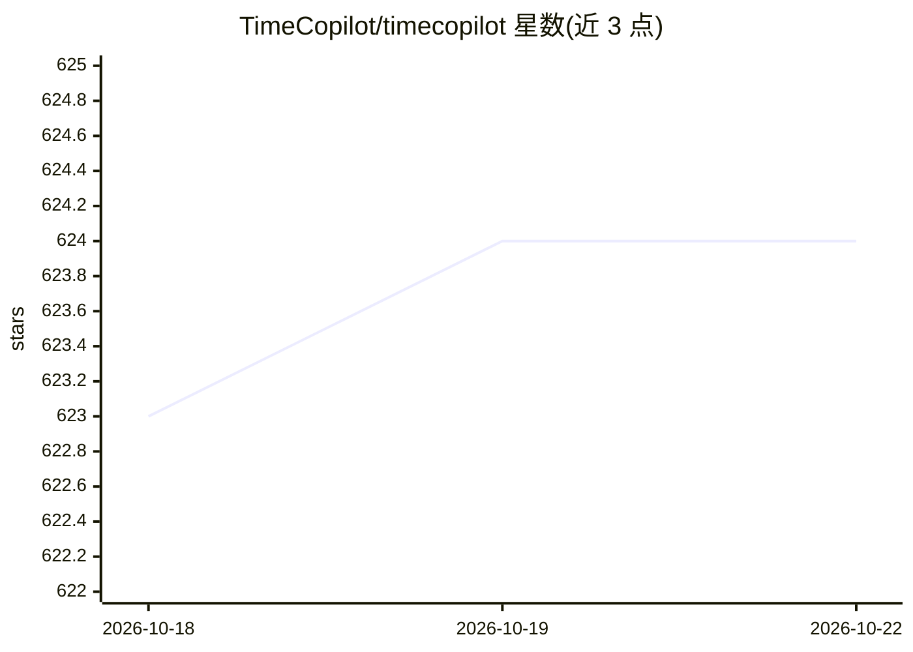

# TimeCopilot/timecopilot

⭐ 624 · Python · MIT · 推送 2026-10-20 · [GitHub](https://github.com/TimeCopilot/timecopilot) · [官网](https://docs.timecopilot.dev/timecopilot) · 组织维护

**自然语言时间序列预测 agent：LLM 组合时序基础模型出预测**

开源 Python 预测 agent（PyPI 包 timecopilot），将 LLM 与 30+ 时间序列基础模型（Chronos、Moirai、TimesFM、TimeGPT 等）组合：LLM 解读统计特征、选择模型、用自然语言解释决策，用户以英文提问即可获得预测、交叉验证、异常检测与模型比较。提供命令行一行式预测（uvx timecopilot forecast <url>）与 Python API。要求 Python 3.10+，默认使用 OpenAI 模型（需 API key），也支持其他兼容端点（要求模型支持工具调用）；不支持 Intel 架构 macOS。

## 筛选速览

| 维度 | 判定 | 备注 |
|---|---|---|
| AI 角色 | `ai-native` | 本体是模型或模型工具 |
| 许可风险 | `permissive` | MIT |
| 部署形态 | `library` | 以包/库形式分发 |
| 模型依赖 | — | README 未给出锁定关系 |
| 硬件要求 | — | 无带数字的原话,不猜 |
| 安装摩擦 | `low` | 无编译、无系统依赖或容器化 |
| 成熟度 | — | 结构信号不足 |

## 能力要点

- 组合 30+ 时序基础模型，LLM 自动选模型并解释决策
- 自然语言提问获得预测、趋势与季节性分析
- 一行命令端到端预测（uvx timecopilot forecast <url>）
- 工作已被 NeurIPS 2025 BERTs Workshop 接收，arXiv 有预印本

## 适用场景

- 用自然语言对业务数据做预测并得到解释
- 对比多个时序基础模型的效果
- 询问预测相关问题（趋势、季节性、未来总量）

## 场景标签

`数据分析` · 领域:效率与自动化

## 证据(README 行号)

> L12: TimeCopilot is an open-source forecasting agent that combines the power of large language models with state-of-the-
> L23: - **Natural-Language Forecasting**. Ask questions in plain English and get forecasts, analysis, validation, and mod
> L35: TimeCopilot is a generative agent that applies a systematic forecasting approach using large language models (LLMs)

## 星数曲线

2026-10-18 623 → 2026-10-22 624（+1）

---
*卡片 v1 · prompt 1.4 · 生成 2026-10-21 · 置信度 high · 依据 README sha `f03ae0be9340` · [字段定义](../../DATASET.md)*
