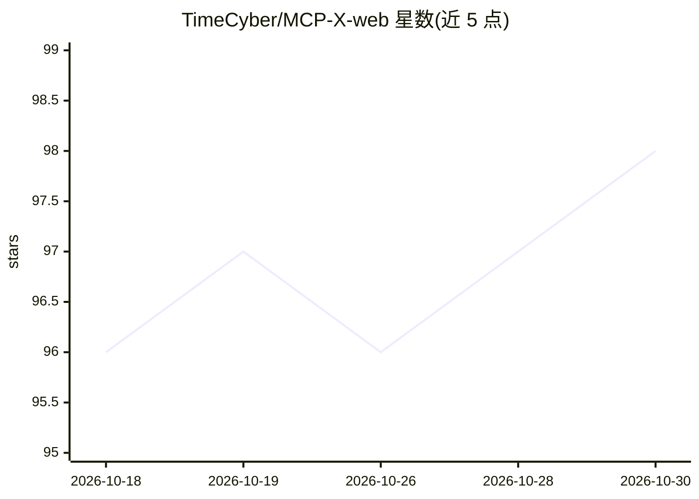

# TimeCyber/MCP-X-web

⭐ 98 · TypeScript · Apache-2.0 · 推送 2026-10-26 · [GitHub](https://github.com/TimeCyber/MCP-X-web) · [官网](https://www.mcp-x.com) · 组织维护 · 中文 README

**企业级 AIGC 工作台前端：对话/生图/生视频/应用构建/MCP市场**

MCP-X 的 Web 前端（React 18 + TypeScript + Vite），对接 mcp-x.com 后端，提供 AI 对话（GPT/Gemini/DeepSeek/Kimi/千问，MCP 工具调用、知识库 RAG）、全流程 AI 视频工作室（剧本解析、分镜、故事板、Seedance/Veo3/可灵等模型）、AI 图像编辑器（文生图/图生图/局部编辑）、对话式前端应用构建（React/Vue/HTML，可导出 PPT），以及 1000+ MCP 工具与 500+ Agent 市场入口。含多租户、中英双语界面。后端代码未开源（设 1000 Stars 开源条件），Apache 2.0 附加商业授权条款。

## 筛选速览

| 维度 | 判定 | 备注 |
|---|---|---|
| AI 角色 | `ai-native` | 本体是模型或模型工具 |
| 许可风险 | `permissive` | Apache-2.0 |
| 部署形态 | `None` |  |
| 模型依赖 | locked-api |  |
| 硬件要求 | — | 无带数字的原话,不猜 |
| 安装摩擦 | `medium` | 含编译或系统依赖之一 |
| 成熟度 | — | 结构信号不足 |

## 能力要点

- AI 视频工作室：剧本解析→分镜/故事板→参考图生视频全流程
- 多模型 AI 对话，支持 MCP 工具调用与企业知识库 RAG
- 对话式前端应用构建，生成网页可实时预览并导出 PPT
- MCP 市场（1000+ 工具）与 Agent 市场（500+ 智能体）入口

## 适用场景

- 在统一工作台里用多模型完成文案、图像与视频创作
- 通过对话生成并迭代前端网页应用
- 浏览和配置 MCP 工具与行业 Agent

## 场景标签

`聊天机器人` `图像生成` `视频生成` `代码生成` · 领域:编码与开发

## 证据(README 行号)

> L5: **一站式 AI 创作工作流平台 · 对话 / 视频 / 图像 / 代码 / Agent / MCP**
> L147: ### 🎬 1. AI 视频工作室（Video Studio）

## 星数曲线

2026-10-18 96 → 2026-10-30 98（+2）

---
*卡片 v1 · prompt 1.4 · 生成 2026-10-23 · 置信度 high · 依据 README sha `c3839c2212a2` · [字段定义](../../DATASET.md)*
