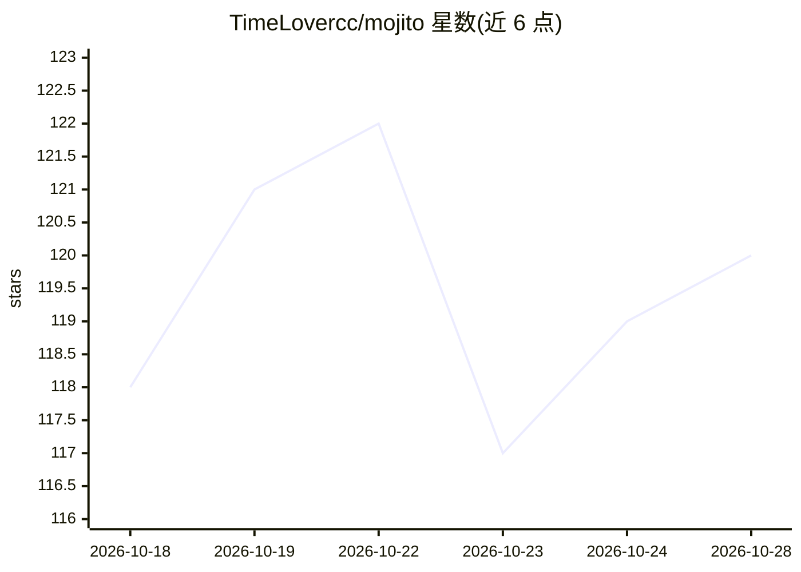

# TimeLovercc/mojito

⭐ 120 · TypeScript · MIT · 推送 2026-10-19 · [GitHub](https://github.com/TimeLovercc/mojito) · [官网](https://timelovercc.github.io/mojito/) · 个人维护 · 中文 README

**自托管的自我进化个人助手：通过对话让 Claude Code 改写应用本身**

单用户本地优先的日常规划应用：包含 Today 页、两周计划、笔记、Feed 与 Chat，外加研究工作区（研究地图、想法收件箱、Idea Lab）。核心机制是“进化循环”：用户在聊天中提需求，运行在自己 Mac 上的 Claude Code 会话读取邮件/日历/文件与应用源码，修改代码并构建、推送到手机、Mac、Web 与服务器；小改动自动上线，大改动等待用户批准（该规则目前靠维护者遵循文档约束，代码尚未强制执行）。后端为自托管 FastAPI + SQLite 的薄 hub。自述为 experimental alpha，需自建服务器、HTTPS 与若干 token。

## 筛选速览

| 维度 | 判定 | 备注 |
|---|---|---|
| AI 角色 | `ai-native` | 本体是模型或模型工具 |
| 许可风险 | `permissive` | MIT |
| 部署形态 | `library` | 以包/库形式分发 |
| 模型依赖 | locked-api |  |
| 硬件要求 | — | 无带数字的原话,不猜 |
| 安装摩擦 | `low` | 无编译、无系统依赖或容器化 |
| 成熟度 | `idea` | |

## 能力要点

- 聊天驱动 Claude Code agent 修改应用代码并多端推送（Web/PWA、Android OTA、Mac 原地更新）
- 本地优先：数据与登录保留在用户自己的 Mac 与 hub 服务器上
- 数据变更有 Undo，风险变更需用户批准（文档约束，代码未强制）
- 内置日常规划功能：Today、计划、笔记、Feed、研究工作区

## 适用场景

- 自托管一个能按我的要求持续改造的个人规划应用
- 让 agent 读取本地邮件/日历/文件生成每日简报与卡片
- 作为“进化应用”研究方向的个人实验部署

## 场景标签

`编码 Agent` `AI 助手` · 领域:编码与开发

## 证据(README 行号)

> L12: **Mojito is an evolving app — it rewrites itself for you.** Tell it in chat what you want, and a Claude Code agent 
> L34: 2. **The agent owns the context.** The agent — Claude Code running on your own Mac (or a Mac mini) — uses what's al
> L98: That's just where it starts. The part worth taking home is the loop around the app. When something bugs you, say so

## 星数曲线

2026-10-18 118 → 2026-10-28 120（+2）

---
*卡片 v1 · prompt 1.4 · 生成 2026-10-23 · 置信度 mid · 依据 README sha `33f789de4aa9` · [字段定义](../../DATASET.md)*
