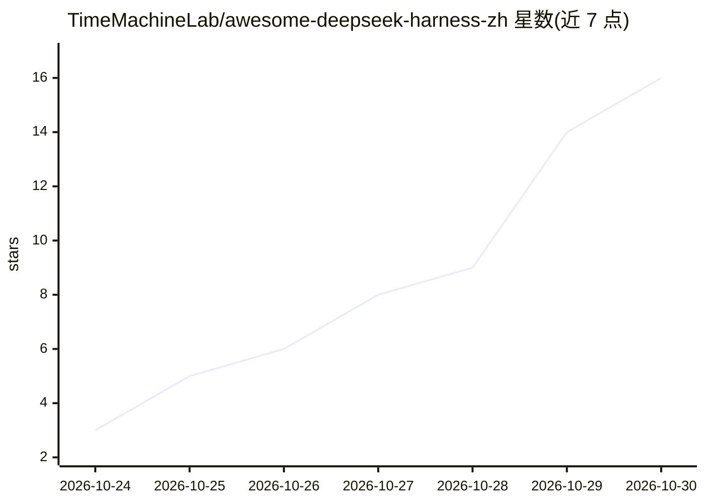

# TimeMachineLab/awesome-deepseek-harness-zh

⭐ 16 · Python · CC0-1.0 · 推送 2026-10-26 · [GitHub](https://github.com/TimeMachineLab/awesome-deepseek-harness-zh) · [官网](https://orbiorbi.com) · 组织维护 · 中文 README

**DeepSeek Harness（dsh）中文使用指南与资源清单**

面向中文用户的 DeepSeek Harness（dsh，DeepSeek 开源的 AI Agent 运行框架）教程与资源合集：讲解桌面版/npx/源码三种安装方式、模型与 API Key 配置（DeepSeek/Kimi/GLM/OpenAI/Anthropic 兼容服务）、隐私设置（默认日志上传与遥测的关闭方法）、常见报错排查，并收录 51 个精选插件、Skills 与中文教程。由 Orbis 团队维护，与 DeepSeek 官方无关联；内容对应 dsh 0.2.1-rc 开发者预览版，声明会有不兼容更新。

## 筛选速览

| 维度 | 判定 | 备注 |
|---|---|---|
| AI 角色 | `ai-knowledge` | 知识聚合/清单类 |
| 许可风险 | `viral` | CC0-1.0 |
| 部署形态 | `library` | 以包/库形式分发 |
| 模型依赖 | locked-api |  |
| 硬件要求 | — | 无带数字的原话,不猜 |
| 安装摩擦 | `low` | 无编译、无系统依赖或容器化 |
| 成熟度 | — | 结构信号不足 |

## 能力要点

- 覆盖安装、模型配置、插件与 Skills 安装、MCP、隐私设置与报错排查的中文教程
- 收录 51 个按用途分类的精选插件与若干 Skills
- 标注 dsh 默认会话日志上传与遥测行为及关闭方法
- 星数表格由 GitHub Actions 每周自动刷新

## 适用场景

- 中文环境下安装并配置 dsh 及 API Key
- 挑选 dsh 插件与 Skills 扩展功能
- 排查 403、UNKNOWN_MODEL、安装卡住等常见报错

## 场景标签

`精选清单` `教程课程` · 领域:学习与行业

## 证据(README 行号)

> L5: **DeepSeek Harness（简称 dsh）是 DeepSeek 开源的 AI Agent 运行框架，采用「万物皆插件」的架构（MIT 协议）。** 本仓库用中文讲清楚 dsh 怎么安装、怎么配模型和 API Key、怎么装
> L18: |定位|开源 AI Agent 运行框架，**一切功能都是插件**：模型、工具、界面、记忆都能替换|
> L57: |插件安装教程与精选插件|`dsh plugin add` 命令、插件市场、51 个精选插件|

## 星数曲线

2026-10-24 3 → 2026-10-30 16（+13）

---
*卡片 v1 · prompt 1.4 · 生成 2026-10-30 · 置信度 mid · 依据 README sha `b7a93f3a30a8` · [字段定义](../../DATASET.md)*
