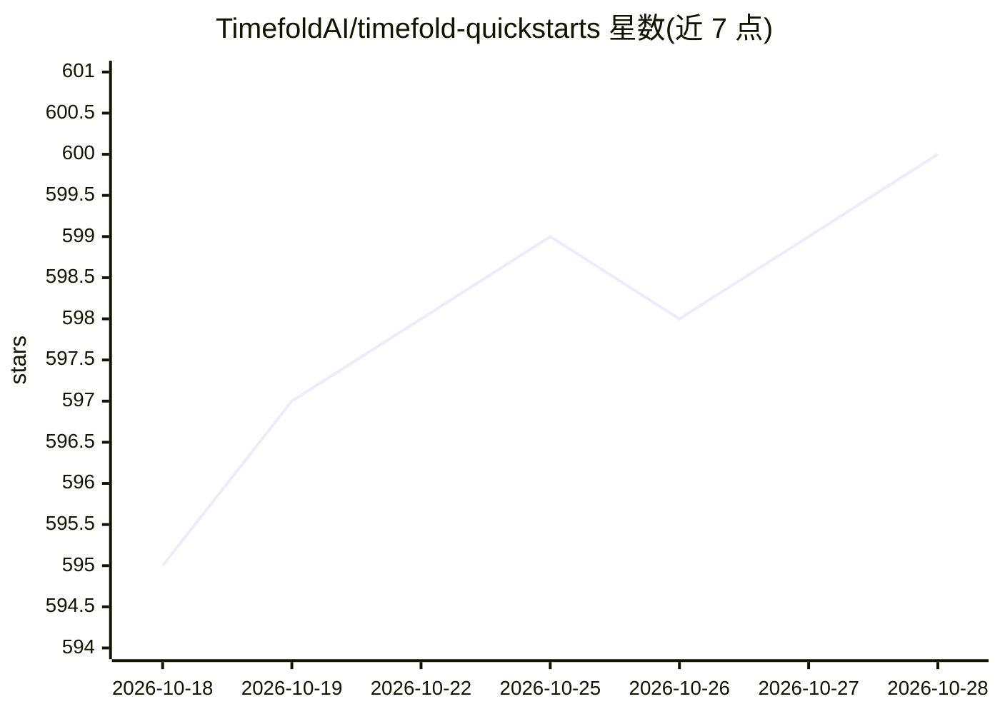

# TimefoldAI/timefold-quickstarts

⭐ 600 · Java · Apache-2.0 · 推送 2026-10-26 · [GitHub](https://github.com/TimefoldAI/timefold-quickstarts) · [官网](https://solver.timefold.ai) · 组织维护

**Timefold Solver 的入门示例集：15 个规划优化用例实现**

TimefoldAI 维护的快速上手代码仓库，为 Timefold Solver（Java/Kotlin 的 AI 约束求解器）提供 15 个用例的参考实现，覆盖车辆路径、员工排班、维护排程、学校课表、病床分配、航班机组排班等规划问题，每个用例标注所涉及的求解器概念（影子变量、链式规划变量、负载均衡等）。入门实现提供 Quarkus 服务、Spring Boot 集成、Kotlin、纯库/控制台等多种工程形态，多基于 Maven，部分支持 Gradle。各示例附带简版 UI 供演示。仓库于 2023 年 4 月从 OptaPlanner Quickstarts 分叉而来，Apache-2.0 许可。

## 筛选速览

| 维度 | 判定 | 备注 |
|---|---|---|
| AI 角色 | `ai-ecosystem` | LLM/agent 周边工具 |
| 许可风险 | `permissive` | Apache-2.0 |
| 部署形态 | `None` |  |
| 模型依赖 | — | README 未给出锁定关系 |
| 硬件要求 | — | 无带数字的原话,不猜 |
| 安装摩擦 | `low` | 无编译、无系统依赖或容器化 |
| 成熟度 | — | 结构信号不足 |

## 能力要点

- 15 个规划优化用例的参考实现，含车辆路径与员工排班
- 每个用例标注求解器概念（Shadow Variables、Chained Through Time 等）
- 覆盖 Quarkus 服务、Spring Boot 集成、Kotlin、纯库/控制台多种工程形态
- 含 Field Service Routing 与员工轮班排班的现成模型提示

## 适用场景

- 上手 Timefold Solver 学习约束求解建模
- 为自己的排班/路径/排课问题找参考实现
- 比较 Quarkus 与 Spring Boot 集成 Solver 的工程方式

## 场景标签

`教程课程` · 领域:学习与行业

## 证据(README 行号)

> L7: This repository contains quickstarts for Timefold Solver, an AI constraint solver for Java and Kotlin.
> L31: > The implementations in this repository serve as a starting point and/or inspiration when creating your own applic

## 星数曲线

2026-10-18 595 → 2026-10-28 600（+5）

---
*卡片 v1 · prompt 1.4 · 生成 2026-10-21 · 置信度 high · 依据 README sha `49658318d1fc` · [字段定义](../../DATASET.md)*
