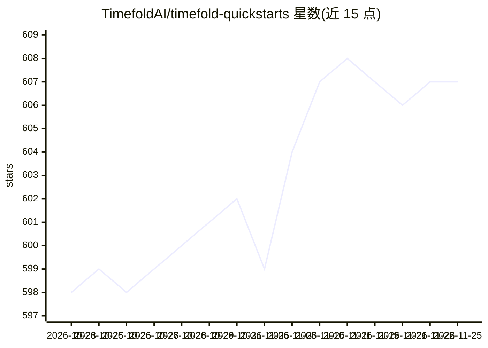

# TimefoldAI/timefold-quickstarts

⭐ 607 · Java · Apache-2.0 · 推送 2026-11-23 · [GitHub](https://github.com/TimefoldAI/timefold-quickstarts) · [官网](https://solver.timefold.ai) · 组织维护

**Timefold Solver 约束求解器的快速上手示例集**

为 Timefold Solver（Java/Kotlin 的约束求解库）提供的一组快速启动示例项目，覆盖车辆路径、员工排班、维护调度、课表编排等 15+ 规划用例，每类附约束展示与 Quarkus/Spring Boot 运行方式。仓库提供 Maven/Gradle 构建的入门指南项目，含简易 UI 与 REST API/控制台两种无 UI 形式。该仓库于 2023 年 4 月从 OptaPlanner Quickstarts 分叉，源码基于 Apache-2.0。

## 筛选速览

| 维度 | 判定 | 备注 |
|---|---|---|
| AI 角色 | `ai-native` | 本体是模型或模型工具 |
| 许可风险 | `permissive` | Apache-2.0 |
| 部署形态 | `None` |  |
| 模型依赖 | — | README 未给出锁定关系 |
| 硬件要求 | — | 无带数字的原话,不猜 |
| 安装摩擦 | `low` | 无编译、无系统依赖或容器化 |
| 成熟度 | — | 结构信号不足 |

## 能力要点

- 15+ 规划用例示例：车辆路径、员工排班、维护调度、课表、床位分配等
- 提供 Quarkus 与 Spring Boot 两种集成示例（Java 与 Kotlin）
- 每类用例附约束定义展示与可运行项目
- 入门指南项目含库模式（控制台/REST API）与服务模式

## 适用场景

- 学习用约束求解器解决排班与路径优化问题
- 为员工排班或车辆路径系统找可改造的起点代码
- 评估 Timefold Solver 在 Quarkus/Spring Boot 中的接入方式

## 场景标签

 · 领域:运筹优化/约束求解

## 证据(README 行号)

> L7: This repository contains quickstarts for Timefold Solver, an AI constraint solver for Java and Kotlin.
> L8: It shows different use cases and basic implementations to get you started on your optimization journey.
> L31: > The implementations in this repository serve as a starting point and/or inspiration when creating your own applic

## 星数曲线

2026-10-23 598 → 2026-11-25 607（+9）

---
*卡片 v1 · prompt 1.4 · 生成 2026-11-25 · 置信度 high · 依据 README sha `85b9d4699461` · [字段定义](../../DATASET.md)*
