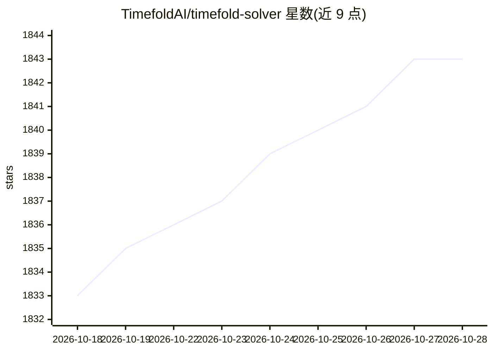

# TimefoldAI/timefold-solver

⭐ 1,843 · Java · Apache-2.0 · 推送 2026-10-27 · [GitHub](https://github.com/TimefoldAI/timefold-solver) · [官网](http://solver.timefold.ai) · 组织维护

**面向 Java/Kotlin 的 AI 约束求解器，优化排班与路径规划**

面向 Java 与 Kotlin 开发者的 AI 约束求解器库，用于求解车辆路径问题（VRP）、员工排班、维护调度、任务分配、学校课表、云计算资源优化、会议排期、作业车间调度等规划问题。由原 OptaPlanner 团队开发，2023 年 4 月从 OptaPlanner 分叉而来。以 Maven 构件形式提供，源码构建需 JDK 21+ 与 Maven 3.9.11+。分为开源的社区版（Apache-2.0）与需商业许可的企业版。

## 筛选速览

| 维度 | 判定 | 备注 |
|---|---|---|
| AI 角色 | `ai-native` | 本体是模型或模型工具 |
| 许可风险 | `permissive` | Apache-2.0 |
| 部署形态 | `None` |  |
| 模型依赖 | — | README 未给出锁定关系 |
| 硬件要求 | — | 无带数字的原话,不猜 |
| 安装摩擦 | `medium` | 含编译或系统依赖之一 |
| 成熟度 | — | 结构信号不足 |

## 能力要点

- 求解 VRP、员工排班、课表、作业车间调度等规划问题
- 由原 OptaPlanner 团队开发，Apache-2.0 分叉
- 提供 Java/Kotlin Maven 构件与 Quickstarts 示例仓库
- 社区版之外另设需许可的企业版

## 适用场景

- 优化物流配送的车辆路径与调度方案
- 生成满足约束的员工排班表
- 求解任务分配与车间作业调度问题

## 场景标签

 · 领域:运筹优化/调度规划

## 证据(README 行号)

> L15: Timefold Solver is an AI constraint solver for Java and Kotlin.
> L16: You can use Timefold Solver to optimize the Vehicle Routing Problem, Employee Rostering,

## 星数曲线

2026-10-18 1,833 → 2026-10-28 1,843（+10）

---
*卡片 v1 · prompt 1.4 · 生成 2026-10-21 · 置信度 high · 依据 README sha `e36ac7c4314f` · [字段定义](../../DATASET.md)*
