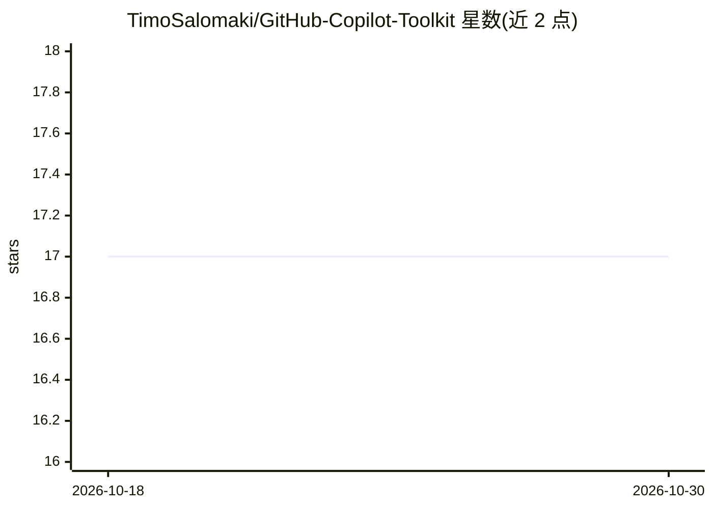

# TimoSalomaki/GitHub-Copilot-Toolkit

⭐ 17 · MIT · 推送 2025-12-07 · [GitHub](https://github.com/TimoSalomaki/GitHub-Copilot-Toolkit) · 个人维护

**面向企业的 GitHub Copilot 提示词与自定义 agent 合集**

个人维护的 GitHub Copilot 资源集合：包含 2 个自定义 agent（Dead Code Detective 识别死代码、Monolith Splitter 分析单体架构拆分）与 5 个提示词（代码考古、架构图生成、依赖链分析、AI 功能规划、多模型 AI Council 等），面向大型、遗留与受监管代码库的企业场景。使用方式为克隆仓库后复制 .github/agents 与 .github/prompts 目录到工作区或 VS Code profile，需 VS Code 且启用 Copilot 的自定义提示/agent 功能。

## 筛选速览

| 维度 | 判定 | 备注 |
|---|---|---|
| AI 角色 | `ai-knowledge` | 知识聚合/清单类 |
| 许可风险 | `permissive` | MIT |
| 部署形态 | `None` |  |
| 模型依赖 | — | README 未给出锁定关系 |
| 硬件要求 | — | 无带数字的原话,不猜 |
| 安装摩擦 | `low` | 无编译、无系统依赖或容器化 |
| 成熟度 | — | 结构信号不足 |

## 能力要点

- 2 个自定义 agent：死代码侦测与单体拆分规划
- 5 个提示词覆盖架构分析、依赖链追踪、AI 功能规划等
- AI Council 提示词实现 Claude/GPT/Gemini 三模型结构化辩论
- 以目录复制方式接入 VS Code 工作区或 profile

## 适用场景

- 在大型遗留代码库中系统性识别和清理死代码
- 为单体应用制定模块化拆分蓝图
- 生成或维护代码库的架构图与依赖分析文档

## 场景标签

`提示工程` `精选清单` · 领域:Agent 开发

## 证据(README 行号)

> L4: This repository contains my collection of GitHub Copilot prompts, agents, and other tools designed to help enterpris
> L47: ## Included Agents
> L55: ## Included Prompts

## 星数曲线

2026-10-18 17 → 2026-10-30 17（+0）

---
*卡片 v1 · prompt 1.4 · 生成 2026-10-29 · 置信度 high · 依据 README sha `99cfcb4ca481` · [字段定义](../../DATASET.md)*
