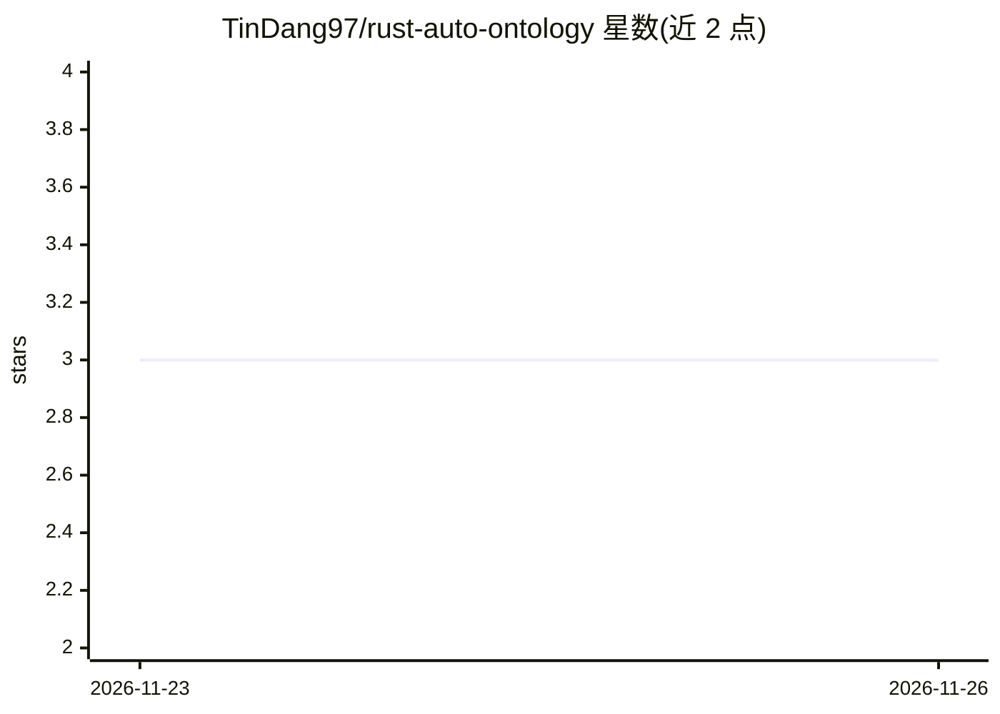

# TinDang97/rust-auto-ontology

⭐ 3 · Rust · Apache-2.0 · 推送 2026-11-09 · [GitHub](https://github.com/TinDang97/rust-auto-ontology) · 个人维护

**用自然语言查询 Postgres 数据库的 Rust 工具，输出只读 SQL 与结果**

NVIDIA Auto Ontology 的 Rust 重写版：先只读摄取数据库结构（表、视图、主外键），由 LLM 编译成包含业务术语、列含义与语义连接路径的本体，并嵌入 pgvector；提问时经 Retrieve→PlanJoins→Generate 流水线生成 SQL。两道独立锁（AST 解析守卫 + 只读连接器）确保 SQL 只读，含提示注入转义与密钥遮蔽。提供 aoq CLI 与 gpui-kit 桌面 Studio。README 声明状态为 MVP，仅支持 Postgres、单用户、本地运行。

## 筛选速览

| 维度 | 判定 | 备注 |
|---|---|---|
| AI 角色 | `ai-native` | 本体是模型或模型工具 |
| 许可风险 | `permissive` | Apache-2.0 |
| 部署形态 | `self-host` | docker 或自建部署 |
| 模型依赖 | local-ok | 支持本地模型 |
| 硬件要求 | — | 无带数字的原话,不猜 |
| 安装摩擦 | `low` | 无编译、无系统依赖或容器化 |
| 成熟度 | `idea` | |

## 能力要点

- LLM 编译数据库结构为本体（术语/属性/语义外键），嵌入 pgvector 检索
- 两道只读锁：SQL AST 守卫解析重渲染 + BEGIN READ ONLY 连接器
- 提示注入防护：非可信文本分块转义，系统消息重试间不变
- 提供 aoq CLI 与基于 gpui-kit 的桌面 Studio 两个入口

## 适用场景

- 用自然语言查询 Postgres 数据库并获得可见的 SQL 与来源表
- 为数据库构建可复用的语义层/本体目录
- 在本地用 Ollama 小模型做 text-to-SQL 试验

## 场景标签

`数据分析` · 领域:效率与自动化

## 证据(README 行号)

> L3: Ask your database questions in plain language and get back **read-only SQL you can see, the rows it returned, and th
> L5: This is a Rust-native rebuild of NVIDIA Auto Ontology. It reads a database's structure, has an LLM compile it into a
> L38: 2. **Compile** (`aoq compile`). For every table without a term, the LLM receives the table's structure plus up to t

## 星数曲线

2026-11-23 3 → 2026-11-26 3（+0）

---
*卡片 v1 · prompt 1.4 · 生成 2026-11-23 · 置信度 mid · 依据 README sha `f62c847a909c` · [字段定义](../../DATASET.md)*
