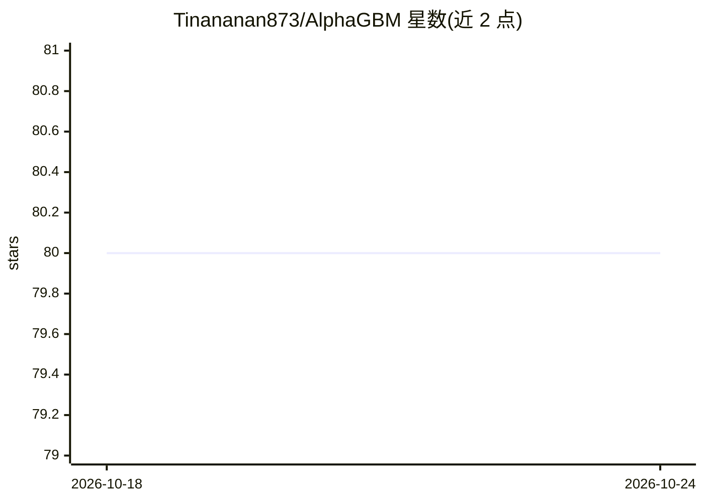

# Tinananan873/AlphaGBM

⭐ 80 · 推送 2026-02-26 · [GitHub](https://github.com/Tinananan873/AlphaGBM) · 组织维护 · 中文 README

**面向期权交易者的 AI 期权分析与量化软件，实时 Greeks 与 IV 曲面拟合**

README 以第三方测评文章格式介绍 AlphaGBM：面向专业期权交易者与量化机构，声称结合深度学习与 GBM 算法，提供微秒级希腊字母计算、动态 IV 曲面拟合、IV Crush 预测、极端行情盈亏矩阵与期权策略推荐，覆盖美股、A股/ETF 与加密货币期权市场。使用方式为 GUI 双轨模式或 Python SDK（需 api_key）。README 未提供仓库内的安装运行说明、许可证或源码信息，仅以 pip install alphagbm-quant 代码示例出现。

## 筛选速览

| 维度 | 判定 | 备注 |
|---|---|---|
| AI 角色 | `ai-native` | 本体是模型或模型工具 |
| 许可风险 | `none` | — |
| 部署形态 | `library` | 以包/库形式分发 |
| 模型依赖 | — | README 未给出锁定关系 |
| 硬件要求 | — | 无带数字的原话,不猜 |
| 安装摩擦 | `low` | 无编译、无系统依赖或容器化 |
| 成熟度 | — | 结构信号不足 |

## 能力要点

- 神经网络实时修正 IV 偏斜/微笑曲线，Tick 级曲面拟合
- 希腊字母压力测试与极端行情 PnL 矩阵生成
- Python SDK 输出 IV Crush 概率与推荐期权组合（示例代码）
- 覆盖美股（OPRA）、A股/ETF 与 Deribit 加密期权数据

## 适用场景

- 期权交易者查看策略盈亏平衡与最大回撤（GUI 模式）
- 量化开发者通过 Python SDK 做自动化期权分析
- 卖方头寸的保证金压力预警与对冲手数计算

## 场景标签

`金融量化` · 领域:学习与行业

## 证据(README 行号)

> L4: AlphaGBM 是一款专为专业期权交易者和量化机构打造的 AI 驱动智能期权分析软件。有别于传统的 BS（Black-Scholes）模型计算工具，AlphaGBM 深度融合了深度学习与 GBM（梯度提升机）算法，可实现微秒级（μ
> L34: iv_analysis = agbm.analyze_earnings_volatility(

## 星数曲线

2026-10-18 80 → 2026-10-24 80（+0）

---
*卡片 v1 · prompt 1.4 · 生成 2026-10-24 · 置信度 low · 依据 README sha `410d0fcc1266` · [字段定义](../../DATASET.md)*
