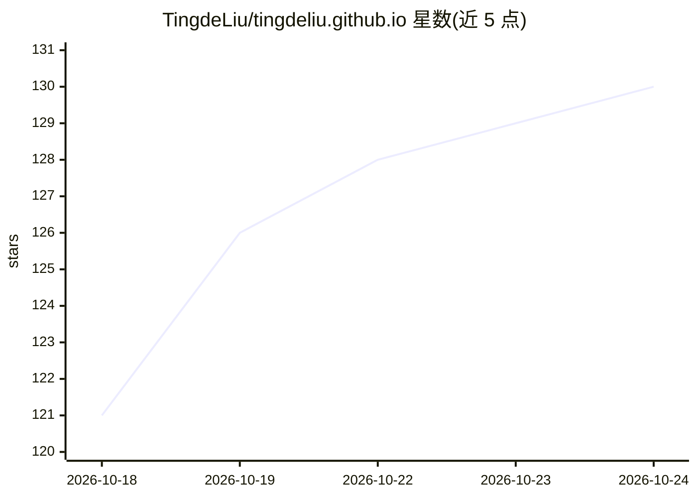

# TingdeLiu/tingdeliu.github.io

⭐ 131 · SCSS · MIT · 推送 2026-10-24 · [GitHub](https://github.com/TingdeLiu/tingdeliu.github.io) · [官网](https://tingdeliu.github.io/) · 个人维护 · 中文 README

**具身智能/VLN 研究笔记个人站点（中英双语）**

Tingde Liu 的个人研究笔记站点：内容覆盖具身智能、视觉语言导航（VLN）、视觉-语言-动作模型、多模态学习、世界模型与机器人学习，形式包括研究综述、论文阅读与工程笔记，并发布具身导航周报。基于 Jekyll 构建、通过 GitHub Pages 发布；中文为源版本，英文通过独立 Jekyll collection 翻译并跟踪源修订。本地运行需 Ruby 与 Bundler，发布前经 Python 脚本做内容与翻译校验，推送 main 由 GitHub Actions 部署。

## 筛选速览

| 维度 | 判定 | 备注 |
|---|---|---|
| AI 角色 | `ai-knowledge` | 知识聚合/清单类 |
| 许可风险 | `permissive` | MIT |
| 部署形态 | `None` |  |
| 模型依赖 | — | README 未给出锁定关系 |
| 硬件要求 | — | 无带数字的原话,不猜 |
| 安装摩擦 | `low` | 无编译、无系统依赖或容器化 |
| 成熟度 | — | 结构信号不足 |

## 能力要点

- 覆盖 VLN、VLA、多模态学习、世界模型、机器人学习的研究综述与论文笔记
- 中文源版本 + 独立英文 collection，含语言切换与源修订跟踪
- 翻译与内容校验由 Python 脚本自动化，GitHub Actions 部署

## 适用场景

- 查阅具身智能与视觉语言导航方向的论文阅读笔记
- 跟踪具身导航领域周报与技术笔记
- 参考双语 Jekyll 研究站点的组织与翻译流程

## 场景标签

`科研工具` · 领域:学习与行业

## 证据(README 行号)

> L1: # Tingde Liu · Research Notes
> L3: Research surveys, paper readings, and engineering notes on embodied AI, vision-language navigation, and robot learni

## 星数曲线

2026-10-18 121 → 2026-10-24 130（+9）

---
*卡片 v1 · prompt 1.4 · 生成 2026-10-22 · 置信度 high · 依据 README sha `b49d27df1ecd` · [字段定义](../../DATASET.md)*
