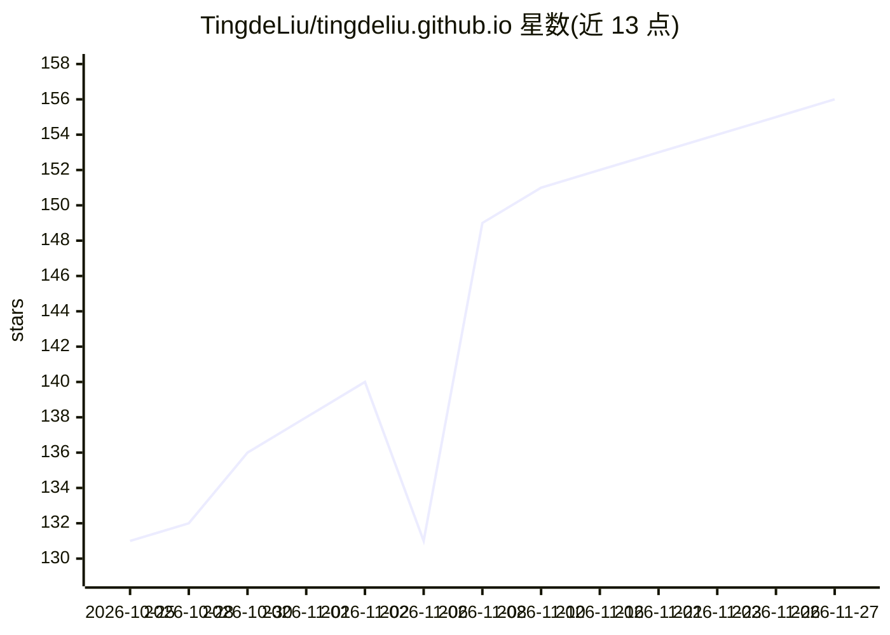

# TingdeLiu/tingdeliu.github.io

⭐ 156 · JavaScript · MIT · 推送 2026-11-26 · [GitHub](https://github.com/TingdeLiu/tingdeliu.github.io) · [官网](https://tingdeliu.github.io/) · 个人维护 · 中文 README

**具身智能与机器人导航领域的个人研究笔记博客**

面向具身智能与机器人领域研究者、学生和工程师的个人研究博客，中文为源版本并提供英文翻译站点。内容覆盖视觉语言导航（VLN）、视觉语言动作（VLA）、世界模型、具身 Agent、空间智能等方向的综述、论文精读与工程实践（ROS 2、Python 工程）。维护流程中使用 AI 助手辅助文献检索、草稿、格式化与校验，作者负责选文与对照原文核实；站点基于 Jekyll 与 GitHub Pages 部署，内置翻译检查与发布前自动化校验脚本。

## 筛选速览

| 维度 | 判定 | 备注 |
|---|---|---|
| AI 角色 | `ai-knowledge` | 知识聚合/清单类 |
| 许可风险 | `permissive` | MIT |
| 部署形态 | `None` |  |
| 模型依赖 | — | README 未给出锁定关系 |
| 硬件要求 | — | 无带数字的原话,不猜 |
| 安装摩擦 | `low` | 无编译、无系统依赖或容器化 |
| 成熟度 | — | 结构信号不足 |

## 能力要点

- 覆盖 VLN/VLA/世界模型/具身 Agent/空间智能等方向的综述与论文精读
- 中英双语站点，翻译状态自动跟踪与检查
- AI 辅助的文献收集—摘要—发布校验维护流程，配套技能仓库 Tyndall-Skills
- 提供导航方向周报与任务类 leaderboard 整理

## 适用场景

- 系统了解视觉语言导航的任务定义、基准与方法演进
- 对比导航方向论文与结果，跟进最新研究
- 参考从论文阅读走向 ROS 2 工程实现的路径

## 场景标签

`科研工具` · 领域:学习与行业

## 证据(README 行号)

> L3: Research notes on **embodied AI, vision-language navigation, and robot learning** — surveys, in-depth paper readings
> L11: This is a personal research blog for researchers, students, and engineers working in embodied AI and robotics. Arti
> L41: The workflow connects literature collection, paper summaries, figure extraction, survey updates, and automated publ

## 星数曲线

2026-10-25 131 → 2026-11-27 156（+25）

---
*卡片 v1 · prompt 1.4 · 生成 2026-11-27 · 置信度 high · 依据 README sha `b829a066e658` · [字段定义](../../DATASET.md)*
