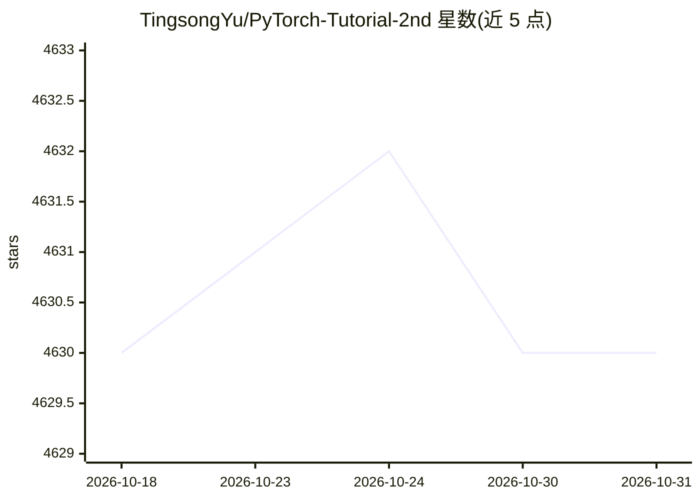

# TingsongYu/PyTorch-Tutorial-2nd

⭐ 4,630 · Jupyter Notebook · 推送 2026-10-29 · [GitHub](https://github.com/TingsongYu/PyTorch-Tutorial-2nd) · [官网](https://tingsongyu.github.io/PyTorch-Tutorial-2nd/) · 个人维护 · 中文 README

**面向深度学习工程师的《PyTorch实用教程》（第二版）开源书与配套代码**

作者 TingsongYu 维护的开源教程书籍（第二版），以在线阅读与配套代码仓库形式提供，采用 CC BY-NC 4.0 许可。内容分三部分：上篇讲 PyTorch 基础与环境搭建，中篇覆盖 CV（分类/分割/检测/跟踪/GAN/Diffusion 等八大任务）、NLP（RNN/LSTM/Transformer/BERT/GPT 与五大任务）及 LLM 部署与 GPT Academic 应用（涉及 Qwen、ChatGLM、Baichuan、Yi），下篇讲 ONNX/TensorRT 推理部署与 PTQ/QAT 量化。面向 AI 自学者、产品经理、在校学生与跨领域人士，设 QQ 交流群。

## 筛选速览

| 维度 | 判定 | 备注 |
|---|---|---|
| AI 角色 | `ai-knowledge` | 知识聚合/清单类 |
| 许可风险 | `none` | — |
| 部署形态 | `None` |  |
| 模型依赖 | — | README 未给出锁定关系 |
| 硬件要求 | — | 无带数字的原话,不猜 |
| 安装摩擦 | `low` | 无编译、无系统依赖或容器化 |
| 成熟度 | — | 结构信号不足 |

## 能力要点

- 三段式结构：入门—应用—落地（CV/NLP/LLM 案例）
- 涵盖 Qwen、ChatGLM、Baichuan、Yi 四个 LLM 的部署与代码分析
- ONNX/TensorRT 部署与 PTQ/QAT 量化实战讲解
- 在线阅读与配套代码均开源免费

## 适用场景

- 零基础入门 PyTorch 并系统学习深度学习
- 查阅 CV/NLP/LLM 项目代码工程
- 学习模型推理部署与量化落地方法

## 场景标签

`教程课程` · 领域:学习与行业

## 证据(README 行号)

> L21: 本书以基础概念为基石，计算机视觉、自然语言处理和大语言模型为核心，推理部署框架为桥梁，皆在为读者提供面向项目落地的代码工程与理论讲解。本书整体分三部分，上篇：入门，中篇：应用，下篇：落地。
> L51: 在LLM章节，包括4个LLM部署与代码分析和一个LLM行业应用——**GPT Academic（GPT 学术优化）**，LLM包括国内开源的四大主流模型，**Qwen、ChatGLM、Baichuan和Yi**。
> L57: 工业落地。有了工具，有了场景，接下来就要让它产生价值，变成可用的、好用的算法服务。因此，从pytorch这样一个训练框架、重框架中剥离出来进行部署、加速、量化是常见的方法。本章将介绍**ONNX和TensorRT**的原理与使用，

## 星数曲线

2026-10-18 4,630 → 2026-10-31 4,630（+0）

---
*卡片 v1 · prompt 1.4 · 生成 2026-10-20 · 置信度 high · 依据 README sha `1b6d384d7dd0` · [字段定义](../../DATASET.md)*
