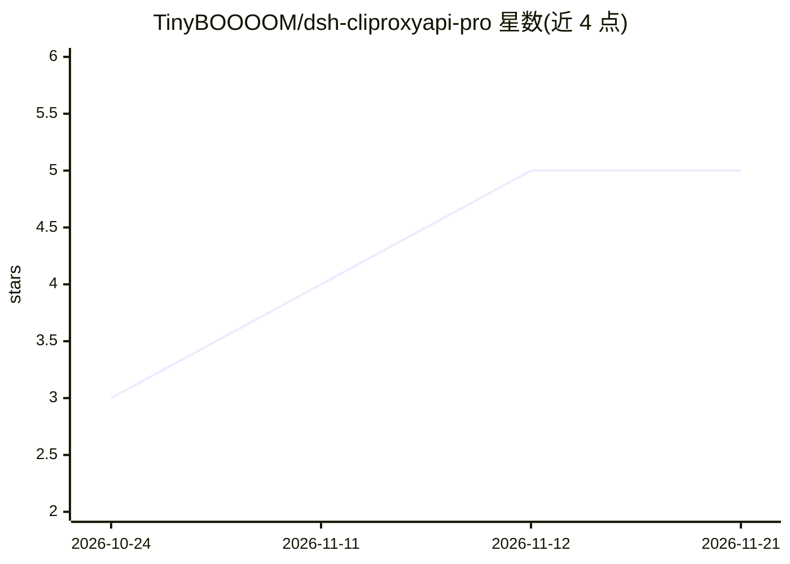

# TinyBOOOOM/dsh-cliproxyapi-pro

⭐ 5 · JavaScript · MIT · 推送 2026-11-17 · [GitHub](https://github.com/TinyBOOOOM/dsh-cliproxyapi-pro) · [官网](https://www.npmjs.com/package/dsh-cliproxyapi-pro) · 个人维护 · 中文 README

**DSH 插件：把 CLIProxyAPI 的模型接入 DSH 模型选择器**

一个 DSH（DeepSeek Harness）插件，读取 CLIProxyAPI（CPA）服务的模型目录，把用户勾选的模型连同上下文长度、图片输入、推理档位同步到 DSH 模型选择器，并按模型家族自动匹配协议（Anthropic Messages / OpenAI Responses / Gemini generateContent / OpenAI Chat）。支持多账号独立配置与启停、按凭证查询渠道剩余额度、经 CPA 生成图片与视频。安装零 npm 依赖，适用于 DSH 0.2.0-rc.1 及以上版本的桌面版与 Web 版。

## 筛选速览

| 维度 | 判定 | 备注 |
|---|---|---|
| AI 角色 | `ai-ecosystem` | LLM/agent 周边工具 |
| 许可风险 | `permissive` | MIT |
| 部署形态 | `None` |  |
| 模型依赖 | — | README 未给出锁定关系 |
| 硬件要求 | — | 无带数字的原话,不猜 |
| 安装摩擦 | `low` | 无编译、无系统依赖或容器化 |
| 成熟度 | — | 结构信号不足 |

## 能力要点

- 自动读取 CPA 模型目录并按家族精选勾选（默认最多 12 个）
- 按模型自动选择原生协议，减少 CPA 的协议转换
- 多账号独立配置，按凭证查看各渠道剩余额度
- 零 npm 依赖，支持插件市场、命令行与 GitHub 多种安装方式

## 适用场景

- 在 DSH 中使用 CLIProxyAPI 聚合的多家模型
- 同时管理多个 CPA 账号并分别勾选模型
- 查看各渠道凭证的剩余额度与重置时间
- 通过 CPA 生成和编辑图片、生成视频

## 场景标签

`模型网关` · 领域:Agent 开发

## 证据(README 行号)

> L9: **把 CLIProxyAPI（CPA）里的模型，一键接进 DeepSeek Harness（DSH）的模型选择器。**
> L11: 填好服务地址和 API Key，插件会自动读取 CPA 的模型目录，把你勾选的模型连同上下文长度、图片输入、推理档位一起同步到 DSH；每个模型自动走它最合适的协议。可以同时接入多个 CPA 账号，每个账号单独启用或停用。
> L15: - **原生协议**：Claude 走 Anthropic Messages，GPT / Codex / Grok 走 OpenAI Responses，Gemini 走 Gemini 原生 `generateContent`（需

## 星数曲线

2026-10-24 3 → 2026-11-21 5（+2）

---
*卡片 v1 · prompt 1.4 · 生成 2026-11-21 · 置信度 high · 依据 README sha `a1625f327521` · [字段定义](../../DATASET.md)*
