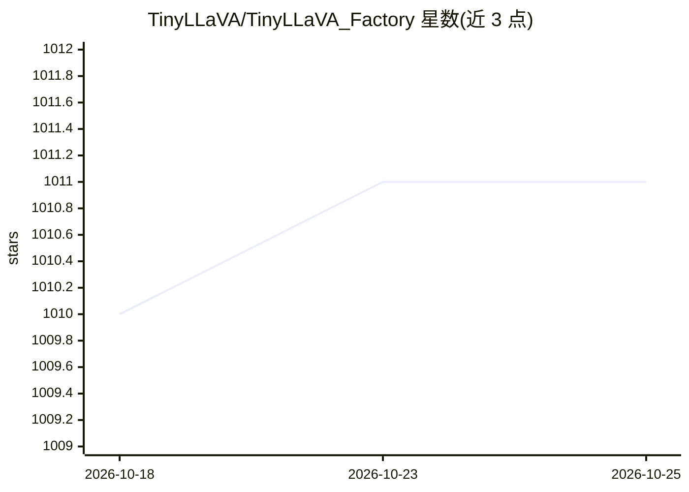

# TinyLLaVA/TinyLLaVA_Factory

⭐ 1,011 · Python · Apache-2.0 · 推送 2026-10-19 · [GitHub](https://github.com/TinyLLaVA/TinyLLaVA_Factory) · [官网](https://arxiv.org/abs/2402.14289) · 组织维护

**小规模多模态大模型的模块化训练代码库**

基于 PyTorch 和 HuggingFace 实现的开源模块化代码库，用于构建、训练和评测小规模大型多模态模型（LMM）。LLM 模块支持 OpenELM、TinyLlama、StableLM、Qwen、Gemma、Phi，视觉塔支持 CLIP、SigLIP、Dino 及其组合，连接器支持 MLP、Qformer、Resampler，训练配方覆盖全量/部分/冻结微调与 LoRA/QLoRA。提供模型动物园、Gradio 本地演示、CLI 推理及自定义新组件的扩展接口。训练需 GPU 资源，安装建议新建 conda 环境并额外安装 flash-attn。

## 筛选速览

| 维度 | 判定 | 备注 |
|---|---|---|
| AI 角色 | `ai-ecosystem` | LLM/agent 周边工具 |
| 许可风险 | `permissive` | Apache-2.0 |
| 部署形态 | `library` | 以包/库形式分发 |
| 模型依赖 | — | README 未给出锁定关系 |
| 硬件要求 | — | 无带数字的原话,不猜 |
| 安装摩擦 | `low` | 无编译、无系统依赖或容器化 |
| 成熟度 | — | 结构信号不足 |

## 能力要点

- 模块化设计：LLM、视觉塔、连接器、训练配方均可替换组合
- 支持 LoRA/QLoRA 与 Frozen/Partially/Fully 多种微调方式
- 提供自定义新 LLM、视觉塔、连接器的扩展文档与示例
- 附带 Gradio 本地演示、CLI 推理及预测可视化工具

## 适用场景

- 用小参数量 LLM 组合训练自己的多模态视觉语言模型
- 在自己的数据集上微调 TinyLLaVA 系列模型
- 复现论文中的多模态模型训练与评测结果
- 研究不同视觉塔与连接器组合对多模态性能的影响

## 场景标签

`多模态` `微调` `模型训练` `模型评测` · 领域:评测与运维

## 证据(README 行号)

> L18: - TinyLLaVA Factory is an open-source modular codebase for small-scale large multimodal models (LMMs), implemented 
> L20: - With TinyLLaVA Factory, you can customize your own large multimodal models with less coding effort and less codin
> L22: - TinyLLaVA Factory integrates a suite of cutting-edge models and methods.

## 星数曲线

2026-10-18 1,010 → 2026-10-25 1,011（+1）

---
*卡片 v1 · prompt 1.4 · 生成 2026-10-21 · 置信度 high · 依据 README sha `eda35cbd7d9f` · [字段定义](../../DATASET.md)*
