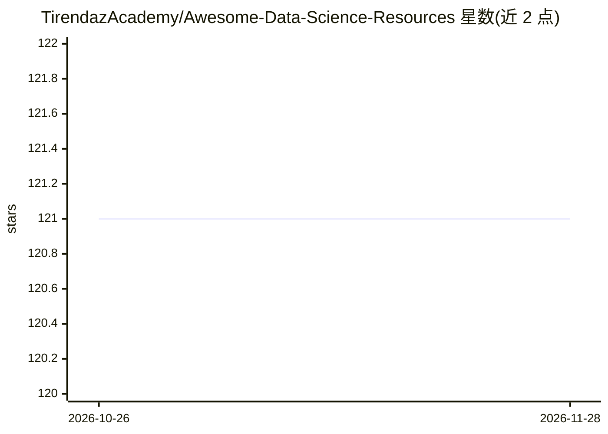

# TirendazAcademy/Awesome-Data-Science-Resources

⭐ 121 · 推送 2026-11-14 · [GitHub](https://github.com/TirendazAcademy/Awesome-Data-Science-Resources) · 个人维护

**数据科学与机器学习学习资源清单（书籍/课程/项目）**

一份按主题组织的资源聚合清单，覆盖数据科学、机器学习、深度学习、MLOps、生成式 AI、NLP、数据工程与 SQL 等板块；每个板块下以条目形式收录免费书籍、博客、课程、项目、框架与工具仓库链接，如 Pandas 教程、TensorFlow/PyTorch 课程、MLflow 等 MLOps 工具条目。内容为外部资源的链接汇编，不含代码实现，维护者声明会持续更新。

## 筛选速览

| 维度 | 判定 | 备注 |
|---|---|---|
| AI 角色 | `ai-knowledge` | 知识聚合/清单类 |
| 许可风险 | `none` | — |
| 部署形态 | `None` |  |
| 模型依赖 | — | README 未给出锁定关系 |
| 硬件要求 | — | 无带数字的原话,不猜 |
| 安装摩擦 | `low` | 无编译、无系统依赖或容器化 |
| 成熟度 | — | 结构信号不足 |

## 能力要点

- 按数据科学/机器学习/深度学习/NLP/数据工程/SQL 等 8 个板块组织条目
- 收录免费书籍、课程、博客、项目、数据集与工具仓库链接
- 包含生成式 AI 与 LLM 相关学习资源条目

## 适用场景

- 寻找数据科学与机器学习方向的入门书籍和课程
- 按板块浏览学习项目与练手数据集
- 查找 PyTorch/TensorFlow 等框架的学习教程链接

## 场景标签

`精选清单` · 领域:学习与行业

## 证据(README 行号)

> L1: # 🔶 Welcome to Awesome Data Science Resources 🔶
> L9: # 🚀 DATA SCIENCE
> L281: 🚀 We'll update this repo once I find new sources so don't forget to watch this repo. If you enjoy this repo, give 

## 星数曲线

2026-10-26 121 → 2026-11-28 121（+0）

---
*卡片 v1 · prompt 1.4 · 生成 2026-11-28 · 置信度 high · 依据 README sha `687f99721eb8` · [字段定义](../../DATASET.md)*
