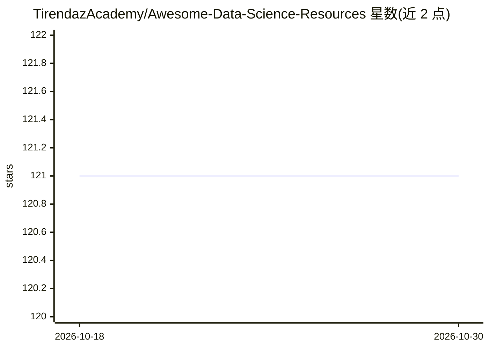

# TirendazAcademy/Awesome-Data-Science-Resources

⭐ 121 · 推送 2026-08-17 · [GitHub](https://github.com/TirendazAcademy/Awesome-Data-Science-Resources) · 个人维护

**数据科学与机器学习学习资源清单（书籍/课程/工具/项目）**

由 Tirendaz Academy 维护的学习资源策展清单，覆盖数据科学、机器学习、ML 工程、深度学习、生成式 AI、NLP/LLM、数据工程与 SQL 八大类目。条目包括免费书籍、博客、课程、YouTube 教程、数据集、实用仓库、项目与工具（如 PyCaret、MLflow、Weights & Biases），均为外链资源而非本仓库实现。不提供安装或运行内容，面向自学者按目录查找学习材料。

## 筛选速览

| 维度 | 判定 | 备注 |
|---|---|---|
| AI 角色 | `ai-knowledge` | 知识聚合/清单类 |
| 许可风险 | `none` | — |
| 部署形态 | `None` |  |
| 模型依赖 | — | README 未给出锁定关系 |
| 硬件要求 | — | 无带数字的原话,不猜 |
| 安装摩擦 | `low` | 无编译、无系统依赖或容器化 |
| 成熟度 | — | 结构信号不足 |

## 能力要点

- 八个学科类目组织资源条目
- 条目类型覆盖书籍、课程、博客、工具、项目、数据集
- LLM/生成式 AI 单独设类，收录 LangChain、OpenAI Cookbook、Cohere LLM University 等资源

## 适用场景

- 按类目查找数据科学/机器学习免费书籍与课程
- 入门数据工程或 MLOps 时查找教程与 Zoomcamp 资源
- 查找 LLM 应用开发的学习材料

## 场景标签

`精选清单` · 领域:学习与行业

## 证据(README 行号)

> L1: # 🔶 Welcome to Awesome Data Science Resources 🔶
> L3: Table of contents:
> L9: # 🚀 DATA SCIENCE

## 星数曲线

2026-10-18 121 → 2026-10-30 121（+0）

---
*卡片 v1 · prompt 1.4 · 生成 2026-10-23 · 置信度 high · 依据 README sha `e45f36430245` · [字段定义](../../DATASET.md)*
