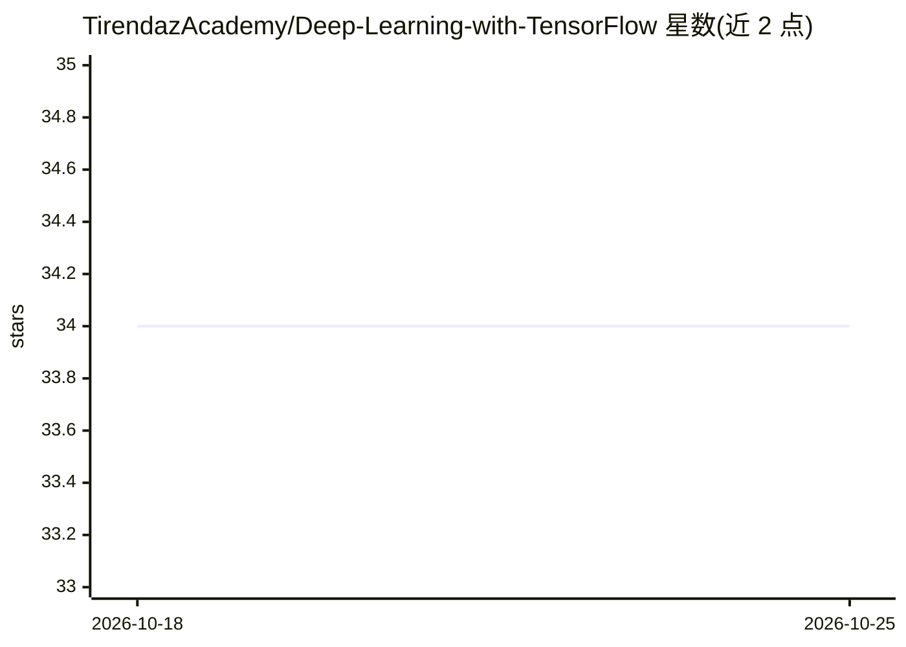

# TirendazAcademy/Deep-Learning-with-TensorFlow

⭐ 34 · Jupyter Notebook · 推送 2026-01-09 · [GitHub](https://github.com/TirendazAcademy/Deep-Learning-with-TensorFlow) · [官网](https://tirendazacademy.medium.com/) · 个人维护

**面向学习者的 Keras/TensorFlow 深度学习教程仓库**

由 TirendazAcademy 维护的深度学习学习资源仓库，包含多个 Jupyter Notebook 教程，主题覆盖神经网络基础、CNN 图像分类、RNN 序列预测、自定义层、模型保存与加载、数据管道与迁移学习，并提供英语与土耳其语两种语言的教程列表。仓库另称附带一组可用于迁移学习或微调的预训练模型（图像分类、目标检测、文本生成等应用）。每个 Notebook 含讲解与代码示例，面向初学者到有经验的深度学习从业者。

## 筛选速览

| 维度 | 判定 | 备注 |
|---|---|---|
| AI 角色 | `ai-knowledge` | 知识聚合/清单类 |
| 许可风险 | `none` | — |
| 部署形态 | `None` |  |
| 模型依赖 | — | README 未给出锁定关系 |
| 硬件要求 | — | 无带数字的原话,不猜 |
| 安装摩擦 | `low` | 无编译、无系统依赖或容器化 |
| 成熟度 | — | 结构信号不足 |

## 能力要点

- Jupyter Notebook 教程覆盖 ANN/CNN/RNN、模型保存加载、数据管道等主题
- 教程文章列表提供英语与土耳其语双语版本
- README 称附带可用于迁移学习/微调的预训练模型

## 适用场景

- 跟随 Notebook 系统学习 Keras 和 TensorFlow 深度学习基础
- 查找图像分类、情感分析等任务的示例代码
- 在自定义数据集上参考迁移学习流程

## 场景标签

`教程课程` · 领域:学习与行业

## 证据(README 行号)

> L3: This repository is designed to provide a comprehensive introduction to deep learning using the Keras and TensorFlow 
> L5: The repository includes several Jupyter notebooks that cover different aspects of deep learning, such as building a 

## 星数曲线

2026-10-18 34 → 2026-10-25 34（+0）

---
*卡片 v1 · prompt 1.4 · 生成 2026-10-25 · 置信度 high · 依据 README sha `01daebe09aea` · [字段定义](../../DATASET.md)*
