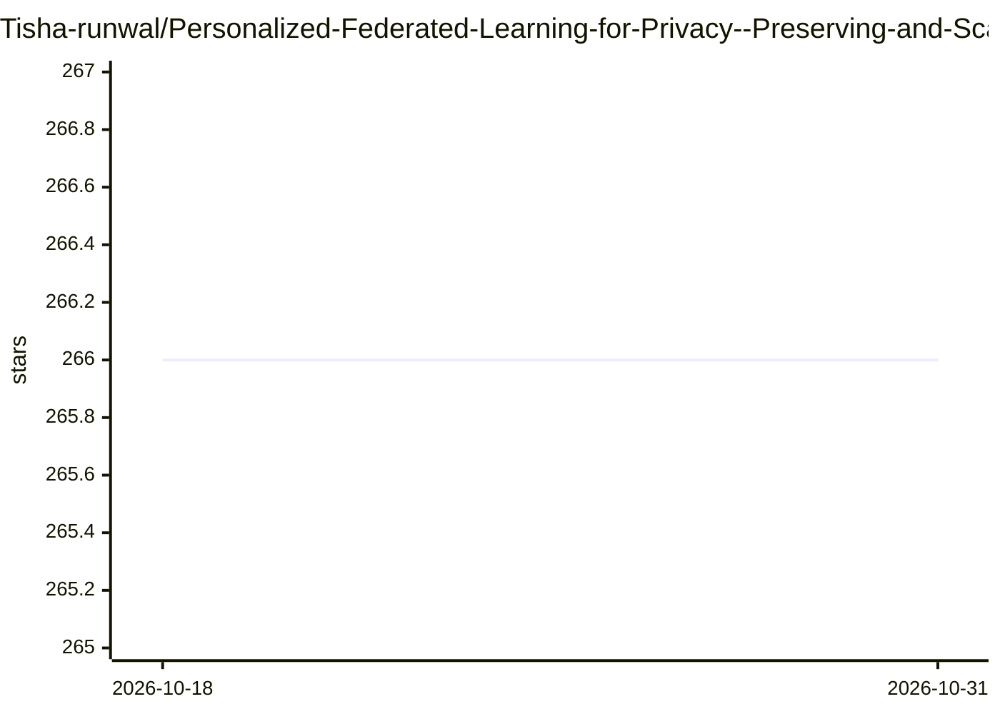

# Tisha-runwal/Personalized-Federated-Learning-for-Privacy--Preserving-and-Scalable-IoT-Driven-Smart-Healthcare

⭐ 266 · Python · MIT · 推送 2026-04-20 · [GitHub](https://github.com/Tisha-runwal/Personalized-Federated-Learning-for-Privacy--Preserving-and-Scalable-IoT-Driven-Smart-Healthcare) · [官网](https://doi.org/10.1109/ICICI65870.2025.11069877) · 组织维护

**面向 IoT 医疗的个性化联邦学习框架，含差分隐私与梯度量化**

ICICI-2025 IEEE 论文的原型实现：基于 Flower 联邦学习与 PyTorch，集成 MAML 元学习个性化、RDP 记账的高斯机制差分隐私、k-bit 梯度量化与基于梯度范数的自适应客户端选择，共实现 FedAvg/FedProx/Per-FedAvg/pFedMe/PFL-HCare 五种策略。模型包括 13 特征医疗生命体征 MLP 与可穿戴设备活动识别 1D-CNN。附 React + FastAPI 实时仪表盘可视化收敛、隐私预算与通信开销。原型 GPU 可选，CPU 可运行；完整复现论文需 NVIDIA A100。

## 筛选速览

| 维度 | 判定 | 备注 |
|---|---|---|
| AI 角色 | `ai-native` | 本体是模型或模型工具 |
| 许可风险 | `permissive` | MIT |
| 部署形态 | `library` | 以包/库形式分发 |
| 模型依赖 | — | README 未给出锁定关系 |
| 硬件要求 | `gpu-24g` | |
| 安装摩擦 | `low` | 无编译、无系统依赖或容器化 |
| 成熟度 | — | 结构信号不足 |

## 能力要点

- MAML 元学习个性化（支持二阶 MAML 与 FOMAML）
- RDP 记账的高斯差分隐私，仪表盘含 σ 滑块
- k-bit 梯度量化降低带宽（8-bit 达 75%）
- 同一 Flower 客户端基础设施下实现五种 FL 策略

## 适用场景

- 在数据不出设备的前提下训练医疗预测模型
- 对比五种联邦学习策略的精度、隐私与通信开销
- 实时监控联邦训练的收敛与隐私预算消耗

## 场景标签

`模型训练` · 领域:训练与推理

## 证据(README 行号)

> L31: The exponential growth of IoT in healthcare has transformed patient monitoring and diagnosis, but traditional centr
> L25: *ICICI-2025, IEEE Xplore · DOI: 10.1109/ICICI65870.2025.11069877*

## 星数曲线

2026-10-18 266 → 2026-10-31 266（+0）

---
*卡片 v1 · prompt 1.4 · 生成 2026-10-22 · 置信度 high · 依据 README sha `c218ce154bcd` · [字段定义](../../DATASET.md)*
