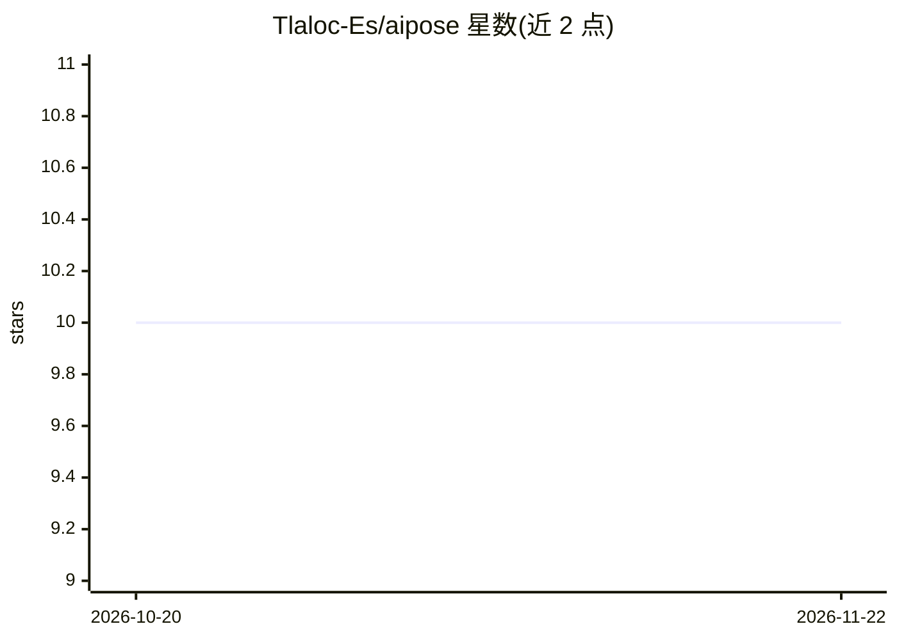

# Tlaloc-Es/aipose

⭐ 10 · Jupyter Notebook · NOASSERTION · 推送 2026-04-23 · [GitHub](https://github.com/Tlaloc-Es/aipose) · [官网](https://pypi.org/project/aipose/) · 个人维护

**面向计算机视觉项目的姿态估计 Python 库**

基于 PyTorch 与 TensorFlow 预训练模型的姿态估计库，提供简易 API 用于检测人体关键点。支持从 PyPI 安装，安装后提供 posewebcam 命令可直接调用摄像头运行 YOLOv7 姿态估计演示。仓库附带 notebooks 示例，覆盖视频/图片/摄像头关键点绘制、举手检测、姿态相似度计算与姿态分类器训练等用法。Linux 下可用 v4l2loopback 与 ffmpeg 模拟虚拟摄像头进行无物理摄像头测试。

## 筛选速览

| 维度 | 判定 | 备注 |
|---|---|---|
| AI 角色 | `ai-native` | 本体是模型或模型工具 |
| 许可风险 | `none` | NOASSERTION |
| 部署形态 | `library` | 以包/库形式分发 |
| 模型依赖 | — | README 未给出锁定关系 |
| 硬件要求 | — | 无带数字的原话,不猜 |
| 安装摩擦 | `medium` | 含编译或系统依赖之一 |
| 成熟度 | — | 结构信号不足 |

## 能力要点

- 提供简易 API 调用预训练姿态估计模型（YOLOv7）
- pip 安装后自带 posewebcam 摄像头演示命令
- notebooks 示例覆盖视频/图片/摄像头关键点绘制、举手检测、姿态相似度与分类器训练
- 支持 Linux 下 v4l2loopback 虚拟摄像头演示

## 适用场景

- 在视频或图片中绘制人体关键点
- 检测画面中是否有人举手并停止视频流
- 计算两个姿态的相似度
- 训练自己的姿态分类器

## 场景标签

`目标检测` · 领域:感知与多模态

## 证据(README 行号)

> L7: Library to use pose estimation in your projects easily.
> L27: Use the following command to run a demo with your cam and YOLOv7 pose estimator,
> L86: - How to stop the video stream when anybody raises hands with YOLOv7

## 星数曲线

2026-10-20 10 → 2026-11-22 10（+0）

---
*卡片 v1 · prompt 1.4 · 生成 2026-11-20 · 置信度 high · 依据 README sha `347202c2464f` · [字段定义](../../DATASET.md)*
