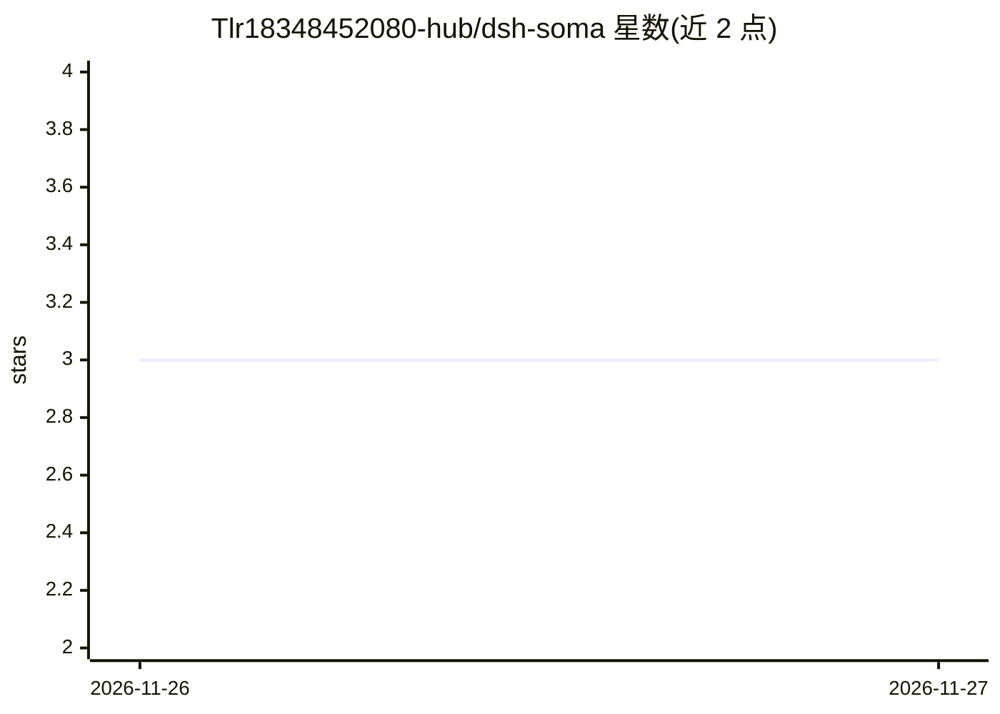

# Tlr18348452080-hub/dsh-soma

⭐ 3 · JavaScript · MIT · 推送 2026-11-20 · [GitHub](https://github.com/Tlr18348452080-hub/dsh-soma) · 个人维护 · 中文 README

**给 AI 提供可演化身体状态的 DeepSeek 插件**

一个 DSH（DeepSeek Harness）插件，用微分方程模拟触觉、温度、疲劳、饥饿、激素等生理通道（42 个皮肤分区、36 个 ERB 耳蜗通道），模型只读一条 [body] 状态行，不能直接设定感觉，只能发送物理量事件（牛顿、摄氏度、cm/s）。提供两个工具 soma_do/soma_note，状态还能改写 maxTokens 影响输出预算。纯 Node ESM 零依赖，支持存档与离线补推。作者注明这不是真正痛觉，也非论文，定位为个人娱乐项目。

## 筛选速览

| 维度 | 判定 | 备注 |
|---|---|---|
| AI 角色 | `ai-ecosystem` | LLM/agent 周边工具 |
| 许可风险 | `permissive` | MIT |
| 部署形态 | `None` |  |
| 模型依赖 | locked-api |  |
| 硬件要求 | — | 无带数字的原话,不猜 |
| 安装摩擦 | `low` | 无编译、无系统依赖或容器化 |
| 成熟度 | — | 结构信号不足 |

## 能力要点

- 生理状态由微分方程积分生成，无 set() 接口，模型只能发事件等结果
- soma_do 万能入口工具，参数为牛顿/摄氏度/cm/s 等物理量
- 常数三级溯源（S/A/G）并带 audit.mjs 自动核查，research/ 附 PMID 文献笔记
- 慢变量按天累积，支持 dump/restore 与离线按步补推（上限 24h）

## 适用场景

- 为 DeepSeek Harness 上的 AI agent 附加持续演化的生理状态模拟
- 让 AI 对话中碰触、疲劳等反馈由方程推算而非提示词标签
- 研究基于物理量的具身化提示对模型输出行为的影响

## 场景标签

 · 领域:AI 工具/具身化模拟

## 证据(README 行号)

> L3: > **A body for AI that actually tires.** Touch, temperature, fatigue, hunger and hormones are integrated as differen
> L97: ## 当插件用

## 星数曲线

2026-11-26 3 → 2026-11-27 3（+0）

---
*卡片 v1 · prompt 1.4 · 生成 2026-11-26 · 置信度 high · 依据 README sha `5b446e2c2f34` · [字段定义](../../DATASET.md)*
