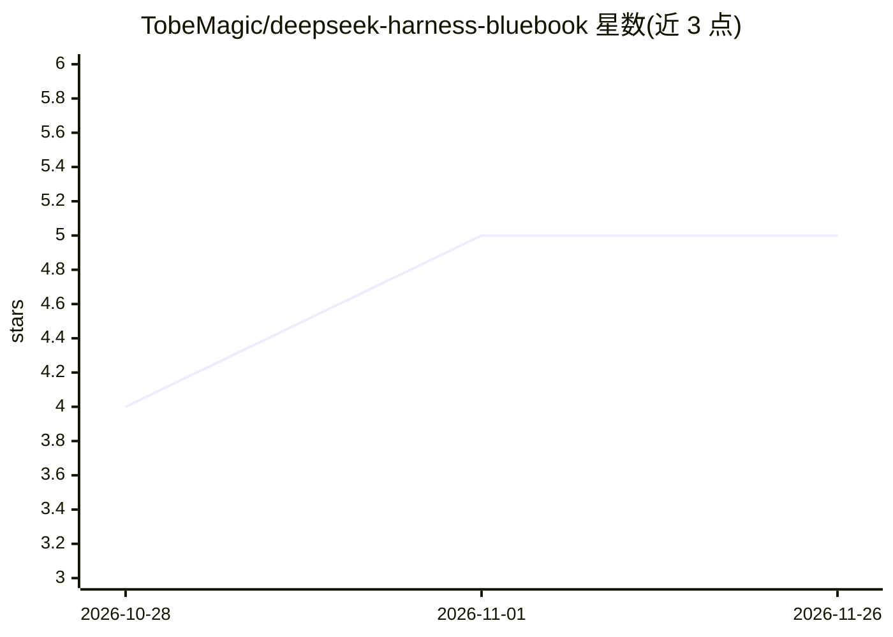

# TobeMagic/deepseek-harness-bluebook

⭐ 5 · HTML · MIT · 推送 2026-10-31 · [GitHub](https://github.com/TobeMagic/deepseek-harness-bluebook) · 个人维护 · 中文 README

**讲解 DeepSeek Harness 设计的中文免费电子书**

「蓝宝书」中文技术丛书首本，对开源 agent 外壳 DeepSeek Harness 做设计解读，约 3.4 万字、42 张手绘图，按序章加 17 节加 3 附录的结构逐层拆解其六层架构、插件机制、事件通信与安全边界。每节含小白版、专业版、术语对照表等双层解释。提供 HTML/PDF/EPUB 三种格式下载与 GitHub Pages 在线阅读，源稿为 Markdown，可用 Python 脚本重新成书。面向不想只学安装、想理解架构并能迁移到自身项目的读者。

## 筛选速览

| 维度 | 判定 | 备注 |
|---|---|---|
| AI 角色 | `ai-knowledge` | 知识聚合/清单类 |
| 许可风险 | `permissive` | MIT |
| 部署形态 | `None` |  |
| 模型依赖 | — | README 未给出锁定关系 |
| 硬件要求 | — | 无带数字的原话,不猜 |
| 安装摩擦 | `low` | 无编译、无系统依赖或容器化 |
| 成熟度 | — | 结构信号不足 |

## 能力要点

- 序章+17节+3附录，约3.4万字、42张手绘图
- 每节双层解释：小白版+专业版+术语对照表
- HTML/PDF/EPUB 三格式，GitHub Pages 在线阅读
- 源稿 Markdown，tools/build_book.py 重新成书

## 适用场景

- 理解 agent harness 的分层架构与插件化设计取舍
- 把书中的设计判据迁移到自己的 agent 项目
- 离线或移动端阅读全书（EPUB/HTML）

## 场景标签

`教程课程` · 领域:学习与行业

## 证据(README 行号)

> L10: 一本免费的设计解读书。**不教你怎么装，教你怎么看懂——以及怎么照着造。**
> L31: DeepSeek Harness 是一个开源的 agent 外壳：模型负责想，它负责让模型够得着真实世界。它最反常识的一件事是——**最中间的那一层可以整块抽走，别处一行都不用改**。连 agent 循环本身都是插件。
> L96: 蓝宝书是一套中文技术丛书，讲「设计解读」——**一本书一个仓库，一本讲透一个系统**。每本都按同一套规范写：双层解释法、图驱动、自包含、不写代码细节。

## 星数曲线

2026-10-28 4 → 2026-11-26 5（+1）

---
*卡片 v1 · prompt 1.4 · 生成 2026-11-21 · 置信度 high · 依据 README sha `911365f50082` · [字段定义](../../DATASET.md)*
