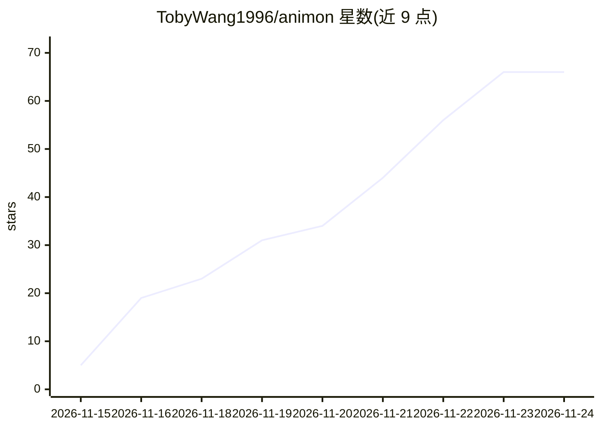

# TobyWang1996/animon

⭐ 80 · Python · Apache-2.0 · 推送 2026-11-17 · [GitHub](https://github.com/TobyWang1996/animon) · 组织维护 · 中文 README

**带角色、长期记忆与关系状态的 AI 陪伴对话原型**

基于 Python 的模块化 AI 陪伴对话原型，提供命令行文字交互与可选语音输入/输出，默认通过 DeepSeek API（OpenAI 兼容接口）生成回复。核心机制：双角色人设（绵绵/砰砰）、从对话抽取关键事实并关键词检索的长期记忆、六轴状态变量（亲密度/情绪等）、表达倾向演化、关系里程碑档案、轻量任务与关键词分级安全约束。语音可选 FunASR 识别加 CosyVoice 本地或 edge-tts 在线合成。成长通过本地状态与提示词上下文实现，不更新模型权重；面向学习与原型验证，运行需自配 API key。

## 筛选速览

| 维度 | 判定 | 备注 |
|---|---|---|
| AI 角色 | `ai-native` | 本体是模型或模型工具 |
| 许可风险 | `permissive` | Apache-2.0 |
| 部署形态 | `desktop` | 安装包/桌面程序 |
| 模型依赖 | locked-api |  |
| 硬件要求 | — | 无带数字的原话,不猜 |
| 安装摩擦 | `low` | 无编译、无系统依赖或容器化 |
| 成熟度 | `idea` | |

## 能力要点

- 双角色人设与按用户×角色分组的长期记忆
- 六轴状态变量随互动与间隔时间更新
- 表达倾向的抽取、强化、衰减与整合机制
- 可选 FunASR 语音识别与 CosyVoice 本地/edge-tts 在线合成

## 适用场景

- 体验带记忆与关系演化的陪伴式对话原型
- 学习分层模块架构的对话 Agent 实现
- 在本地 SQLite 基础上做二次开发与扩展

## 场景标签

`聊天机器人` `AI 助手` · 领域:对话与助手

## 证据(README 行号)

> L15: Animon 是一个基于 Python 的模块化 AI 陪伴对话原型。它将角色设定、长期记忆、情绪状态、表达倾向和关系档案连接起来，使持续对话能够参考以往互动，而不局限于单次问答。
> L17: 项目提供命令行文字交互和可选的语音输入 / 输出，默认通过 DeepSeek API 生成回复。本项目中的“成长”由本地持久化状态、记忆和提示词上下文实现，不涉及在线更新大模型权重。

## 星数曲线

2026-11-15 5 → 2026-11-24 66（+61）

---
*卡片 v1 · prompt 1.4 · 生成 2026-11-18 · 置信度 high · 依据 README sha `3d31965c5c7a` · [字段定义](../../DATASET.md)*
