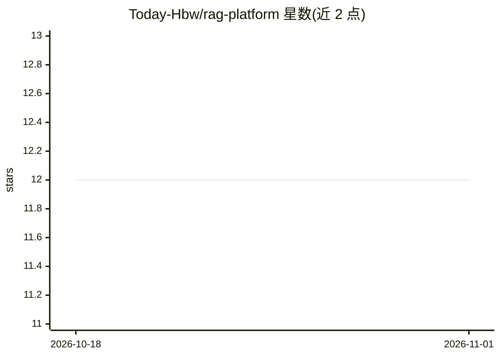

# Today-Hbw/rag-platform

⭐ 12 · Python · MIT · 推送 2026-09-07 · [GitHub](https://github.com/Today-Hbw/rag-platform) · 个人维护 · 中文 README

**开源 RAG 平台：多源摄取、混合检索与租户隔离 API**

面向应用与 AI agent 的检索增强生成平台，分为五个 uv workspace 包：rag-core（共享配置/向量存储/RBAC 数据访问）、rag-pipeline（离线摄取管线）、rag-search（FastAPI 混合检索服务）、rag-api（版本化多租户文档生命周期 API）、rag-mcp（独立 MCP 客户端）。混合检索结合向量相似度、BM25 与标题相关性并用倒数排名融合，返回文档 ID、chunk ID、来源 URL 与字符位置等引用信息。支持 Yuque 与本地 Markdown 连接器、异步摄取、幂等写入、知识库与文档级 RBAC。当前版本 0.1.0，处于积极开发中，公开 API 可能变动。

## 筛选速览

| 维度 | 判定 | 备注 |
|---|---|---|
| AI 角色 | `ai-ecosystem` | LLM/agent 周边工具 |
| 许可风险 | `permissive` | MIT |
| 部署形态 | `self-host` | docker 或自建部署 |
| 模型依赖 | — | README 未给出锁定关系 |
| 硬件要求 | — | 无带数字的原话,不猜 |
| 安装摩擦 | `low` | 无编译、无系统依赖或容器化 |
| 成熟度 | `idea` | |

## 能力要点

- 五包独立部署架构，摄取与查询共享嵌入与 Qdrant payload 契约
- 向量+BM25+标题相关性经 RRF 融合的混合检索
- 租户/知识库隔离 API，幂等写操作与陈旧任务恢复
- MCP 客户端将检索暴露为模型可用工具

## 适用场景

- 为 AI agent 提供带引用与租户隔离的检索服务
- 从 Yuque 或本地 Markdown 摄取并索引多模态内容
- 评估与回归对比检索质量（hit rate/MRR/NDCG）

## 场景标签

`RAG` · 领域:知识与检索

## 证据(README 行号)

> L8: An open-source retrieval-augmented generation platform for ingesting knowledge from multiple sources, indexing multi
> L10: RAG Platform separates ingestion, indexing, retrieval, lifecycle management, and agent integration into independent

## 星数曲线

2026-10-18 12 → 2026-11-01 12（+0）

---
*卡片 v1 · prompt 1.4 · 生成 2026-11-01 · 置信度 high · 依据 README sha `e371fa181566` · [字段定义](../../DATASET.md)*
